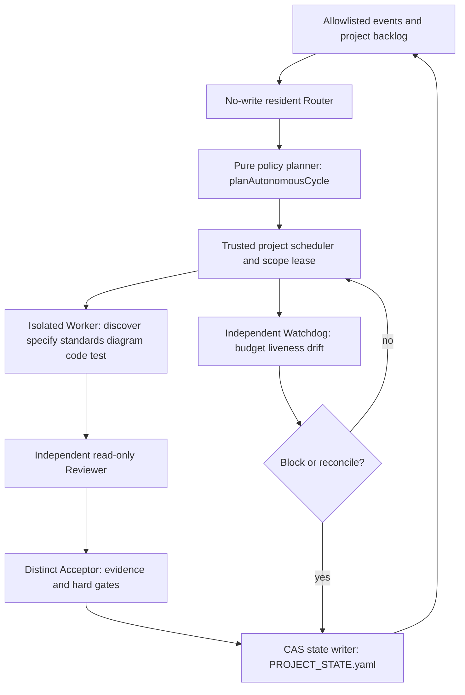
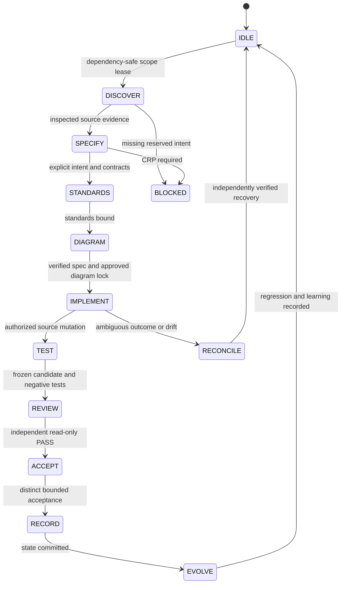

# Autonomous development engine — project-bound integration contract

This is a **delegated technical reference**, not a fourth governance authority. Governance OS remains an unbound source package until separately accepted and project-bound. The engine is dependency-free and provides a policy/dispatch interface, not a built-in AI provider, scheduler, trusted clock, sandbox or deployment service.

## Architecture





## Host adapter required methods

`executeAutonomousCycle(state, host)` requests the following methods from the **trusted project-side host**. The host—not this package—must authenticate role/process identities, isolate permissions, implement durable state writes and enforce actual expenditure ceilings.

- `trustedNow`: trusted RFC 3339 time.
- `attestControlPlanes(state, plan)`: authenticates the Router/Watchdog and verifies their no-mutation/no-acceptance privilege boundaries from the trusted host. A boolean mock is not OS isolation proof.
- `authenticateActors(state, plan)`: returns authenticated ID set and exact state revision.
- `acquireScopeLease({scope,objective_ref,expected_revision,budget_ref})`: returns exclusive lease with matching revision and scope. Must reject overlapping hierarchical scopes and expire stale leases safely.
- `authorizeMandate(plan)`: validates authorized scope, actual limits, tool allowlist, and no external effects; returns exact revision, scope and budget reference with `limits_enforced`, `tools_within_allowlist`, `external_effects_disabled` acknowledgements.
- `verifyPreCodeAuthorization(request)`: trusted, independently reviewed bound diagram/spec/source-write authorization, as specified in `verify-package.mjs`.
- `executeStep(plan)`: dispatches isolated and least-privilege Worker, Reviewer or Acceptor processes. Reviewer's source access MUST be read-only. Returns a candidate-bound phase receipt, never a fabricated review.
- `verifyReceipt({receipt,plan,identity,lease})`: independently proves actor identity, source, immutable evidence, stage/receipt authenticity and policy compliance.
- `commitStateCAS({expected_revision,proposed_state,receipt,reason})`: atomic revision-checked commit under the sole authorized writer, with append-only receipt persistence. Proposals are not automatically trusted proof of quality. This method must also verify phase-to-phase proof and external evidence before accepting altered state.
- `releaseScopeLease({lease_ref,scope})`: release on a valid lease identity; expired or uncertain leases need guarded reconciliation.

The runtime must bind a real model/agent provider, tools, permissions, secret storage, subprocess sandbox, local repository, scheduler, event intake and oversight as appropriate. These are intentionally **not present** in the project-neutral universal distribution. Never equip the Router or Watchdog with developer code-write/merge/deploy roles.

## Owner autonomy policy

Technical design decisions, standards selection, test writing, bug repair, documentation and review can proceed unattended **within a pre-authorized bounded mandate**. Missing product goals, new business/legal exposure, payment/credit/credential grants or production deployments remain explicit owner/authorized-party decisions. An unanswered owner CRP blocks only affected scope, not all projects or unrelated objectives. Silence by default; report actual milestone evidence, meaningful incidents or reserved decisions, not ritual check-ins.

## Limits and non-goals

- Pure `planAutonomousCycle` is inspect-only and does not schedule or mutate anything.
- `executeAutonomousCycle` runs **one host-mediated bounded phase** and returns; only an external scheduler can make it recurrent.
- The structural verifier cannot prove real agent isolation, reviewer independence, complete standards coverage, diagram-code fidelity, correct business intent, concurrency atomicity or safe production effects.
- `AUTONOMY_INACTIVE` in the unbound ZIP is intentional. Do not activate the template, claim complete execution, or treat passing synthetic tests as an independent acceptance or deployment grant.
- Governance changes must be reviewed with separate qualified Worker/Reviewer/Acceptor identities, and adoption/migration must preserve the previously accepted baseline and NO-GO history.

## Smoke test

```sh
node tools/verify-package.mjs
node tools/test-verify-package.mjs
node tools/test-autonomy-engine.mjs
node tools/autonomy-engine.mjs --plan
```

## Missing-specification recovery

`specification_gate.missing_kind=TECHNICAL` with structured missing prompts permits bounded Worker-only standards research through the delegated host; its output is **not** a proof that the specification is now verified. The trusted project reviewer/acceptor must bind the adopted technical decision and update `SPEC_VERIFIED` before source writes. Repeated research with no accepted resolution exhausts `autonomy.max_retries` and stops. `OWNER_INTENT` and `MIXED` do not authorize technical guessing; issue a CRP and continue disjoint eligible scopes.

## r3 scope-switch discipline

On selecting an objective with a different `subject_scope`, `executeAutonomousCycle` resets the active `specification_gate` to `UNVERIFIED` / `DIAGRAM_PENDING`, clears previous dimension, standards, diagram, approval and digest refs, and binds the new scope. This deliberately does not auto-verify the new specification. The trusted project host must obtain an independently reviewed, scope-bound diagram/specification receipt and commit the new gate under CAS before `IMPLEMENT` or any post-diagram phase may advance. The frozen subject digest must match. `current_objective` is synchronized on objective selection and cleared when the cycle returns to `IDLE`. A generic test adapter cannot establish actual diagram or standards conformance.
