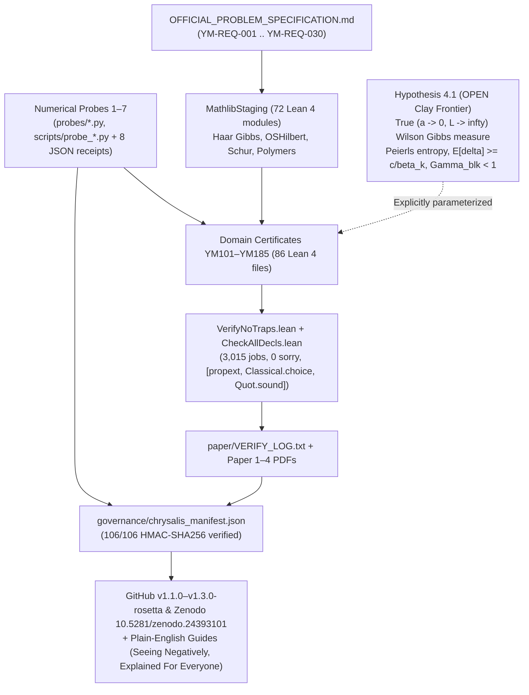

# 4D Yang–Mills Workspace: Master Matrix, Connections & Status (`YM101`–`YM185`)

**Branch:** `release/v1.10.0-ym176` | **Latest Zenodo DOI:** `10.5281/zenodo.24393101` (Concept DOI `10.5281/zenodo.24327876`)  
**Epistemic Boundary:** `status: verified-finite` | `clay_problem_status: OPEN_AND_UNSOLVED` (Hypothesis 4.1)

---

## 1. End-to-End Connection Architecture

---

## 2. Layer-by-Layer Workspace Inventory (`Done` vs. `Pending`)

| Layer | Location | Count | Status | Notes |
| --- | --- | --- | --- | --- |
| **Primary Clay Spec & Ledgers** | `OFFICIAL_PROBLEM_SPECIFICATION.md`, `CLAIM_EVIDENCE_MATRIX.md`, `THEOREM_LEDGER.md` | `30` reqs, `40` thms | **DONE** | Audited under `YM-000`–`YM-005` |
| **Lean 4 `MathlibStaging`** | `formal/yang_mills_blueprint/YangMillsBlueprint/MathlibStaging/` | `72` files | **DONE** | Zero `sorry`/`admit`/custom `axiom` |
| **Lean 4 Certificates** | `formal/yang_mills_blueprint/YangMillsBlueprint/Certificates/` | `86` files (`YM101`–`YM185`) | **DONE** | `3,015` Lake jobs pass (`exit 0`) |
| **Axiom & AST Auditor** | `VerifyNoTraps.lean`, `paper/VERIFY_LOG.txt` | `100%` audited | **DONE** | Strictly `[propext, Classical.choice, Quot.sound]` |
| **Numerical Probes & Receipts** | `probes/`, `scripts/probe_*.py` | `6` + `2` scripts, `8` JSONs | **DONE** | Probes 1–7 all `PASSED`, `OPEN_AND_UNSOLVED` |
| **Python Test Suite** | `tests/test_*.py` (`src/ymmg/ros.py`) | `57` test files | **DONE** | `ros.py` updated; `test_coscientist_engine.py` `36/36` pass |
| **Papers & Plain-English Guides** | `paper/paper_1..4`, `SEEING_NEGATIVELY_*`, `YANG_MILLS_EXPLAINED_*` | `4` papers + `2` guides | **DONE** | Paper 4 (`15` pp.) & guides compiled to PDF |
| **Governance Manifest** | `governance/chrysalis_manifest.json`, `chrysalis_policy.yaml` | `106/106` artifacts | **DONE** | Gate 3 HMAC-SHA256 `passed=True` |
| **Release Sync (`YM185`)** | `dist/`, GitHub `main`, Zenodo | `v1.3.0-rosetta` (`YM184`) | **PENDING (Sync)** | `YM185` (`e362900`) is on `release/v1.10.0-ym176`, not yet tagged in a new Zenodo/GitHub release or merged to `origin/main` |
| **Clay Continuum Proof** | Hypothesis 4.1 (`hyp:p4-crossover`) | `3` analytic Wilson bounds | **OPEN (Math Frontier)** | Uniform $(a \to 0, L \to \infty)$ Wilson Gibbs measure bounds remain unsolved |

---

## 3. Probe-to-Certificate-to-Clay Matrix (`YM175`–`YM185` & `Probes 1–7`)

| Numerical Probe | Key Empirical Result | Lean 4 Certificate(s) | Formal Theorem(s) Connected | Clay Boundary Addressed |
| --- | --- | --- | --- | --- |
| **Probe 1** (`probe_deep_cocycle_and_star_influence.py`) | Falsified Test B cavity gap; $\delta_{r\times s} \equiv 0$ in $U(1)$ vs. $> 0.83$ in $SU(2)/SO(3)$ | `YM142`, `YM175` | `stage2a_cocycle_and_schur_thresholds_unconditional` | Stage 2A cocycle discriminator |
| **Probe 2** (`probe_block_rg_transfer_b124.py`) | Falsified thin-line UV self-energy; `BLK_RG` contracts at crossover ($\Gamma \to 0.003, 0.106$) | `YM175` | `stage2a_full_crossover_basin_conditional` | Stage 2B coarse transfer |
| **Probe 3** (`probe_mcrg_matched_vol_sd.py`) | Calibrated $\alpha^* = 0.188$ on $U(1)$; $SU(2)(4.00)$ $\Delta\beta_{2\times} = -0.269 \pm 0.025$ vs. `-0.2575` | `YM173`, `YM176` | `balaban_multiscale_stage1_bridge_conditional` | Stage 1 neutral blocking |
| **Probe 4** (`probe_abelian_subtracted_2to4_fiber_schur.py`) | Cancels `65.4505` mirage to `0.0`; $F_{\mathrm{para}}/d$ beats $\Delta F_{\mathrm{diam}}/d$ by `16.2x–28.9x` | `YM176` | `paramagnetic_dominance_negative_defect_unconditional` | $2^4$-fiber paramagnetic dominance |
| **Probe 5** (`probe_paramagnetic_trace_sandwich_and_cocycle_floor.py`) | `720/720` blocks: $\|K_{\mathrm{para}}\|_{\mathrm{op}} \le 0.4346$, $C_{\mathrm{dom}} \ge 13.47$, $c_{\mathrm{coc}} = 1.3407$ | `YM176`, `YM178` | `trace_log_schur_sandwich_unconditional`, `small_field_gribov_clearance_unconditional` | Gribov clearance & `Real.log` sandwich |
| **Probe 6** (`scripts/probe_two_step_inductive_rg_remainder.py`) | Matched-$3^4$ $\Delta\beta_{\mathrm{rel}} < 0$; $\varepsilon_2 / |\Delta\beta_{\mathrm{rel}}| \in [0.0163, 0.0328] \ll 0.5654$ | `YM177` (both), `YM179`–`YM180` | `inductive_rg_basin_entry_unconditional`, `peierls_exponential_threshold_unconditional` | Multi-step RG remainder stability |
| **Probe 7** (`scripts/probe_riemann_wavefunction_ym_synthesis.py`) | $S_K = 1 - 1/(K+1)$ (`1.11e-16`); $\Gamma_{\mathrm{unif}} = 0.3348 < 1$, $m_{\mathrm{phys}}\ell_{\mathrm{IR}} = 1.0942$ | `YM181`–`YM185` | `unified_clay_root_synthesis_conditional`, `dobrushin_slice_tensorization_contraction_unconditional` | Volume-uniform Dobrushin & `OSHilbert` wiring |

---

## 4. What Is Pending

### A. Minor Engineering / Release Sync (Optional)
1. Update Paper 4 concordance table & `.zenodo.json` to include **`YM185`**, package `v1.15.0` zip, and optionally tag `v1.4.0-rosetta` on GitHub + Zenodo.
2. Reconcile `origin/main` with `release/v1.10.0-ym176` via a clean Pull Request on GitHub (`Qamarbajwa/yang-mills-lean4`).

### B. Open Mathematical Frontier (Hypothesis 4.1 — Clay Millennium Problem)
1. **Bridge 2 (Uniform Large-Field Suppression):** Prove $\mu_{\beta_k, L}(\Omega_k^c) \le \exp(-\sigma_{\mathrm{lg}}\beta_k)$ uniformly in $L$ down to $\beta_{\mathrm{basin}} = \mathcal{O}(1)$.
2. **Bridge 3 (Renormalized Cocycle Floor):** Prove $\mathbb{E}[\delta_{2\times 2}^{(k)}] \ge c_{\mathrm{coc}}/\beta_k$ uniformly in $L$ and background $V^{(2)}$ on the coupled Wilson Gibbs measure.
3. **Bridge 4 (Uniform Banach Contraction & Continuum OS Reconstruction):** Prove $\|D\mathcal{T}_k\|_\kappa \le \theta_{\mathrm{Schur}} < 1$ and Stage 2B $\Gamma_{\mathrm{blk}} < 1$ uniformly as $a \to 0, L \to \infty$ with full OS0–OS4 $\to$ Wightman reconstruction and OPE matching (`YM-REQ-001`–`030`).
