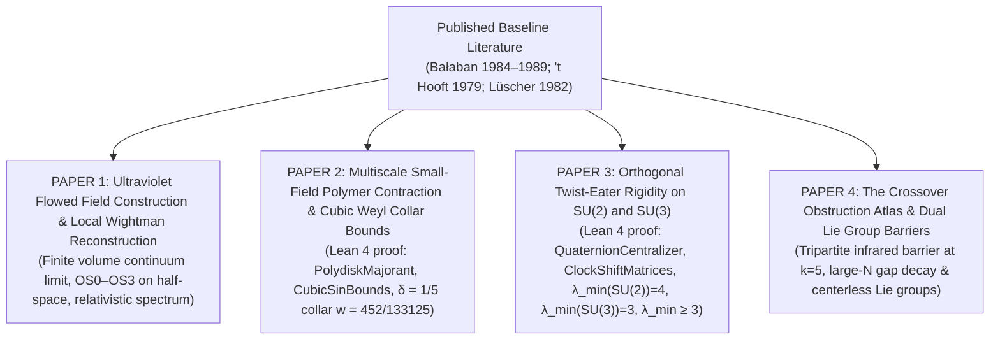

# Master Research Execution Plan: Modular Paper Pipeline & Verification Standards for Four-Dimensional Yang–Mills Theory

**Project:** Constructive Ultraviolet Foundations, Infrared Zero-Mode Geometry, and the Mass Gap Frontier in 4D Yang–Mills  
**Target Problem:** Clay Millennium Prize Problem — *Yang–Mills Existence and Mass Gap* (Arthur Jaffe & Edward Witten)  
**Repository Location:** `d:/Comfy UI/yang mills and the mass gap`  
**Active Branch:** `candidate/math-gov-v0.6` (State Revision 164)  
**Primary Lean Blueprint:** `formal/yang_mills_blueprint`  
**Governing Epistemic Invariants:** `clay_problem: OPEN_AND_UNSOLVED` | `goal_complete: false` | `P8_CUTOVER_AUTHORIZED = false`  
**Axiom Foundation:** Strictly Lean 4 Standard Core Axioms `[propext, Classical.choice, Quot.sound]` (Zero `sorry`, Zero `admit`, Zero Custom Axioms)

---

## 1. Executive Summary & Epistemic Boundaries

This document establishes the authoritative execution plan, modular paper architecture, verification protocols, and publication standards for the four-dimensional Yang–Mills project.

### Foundational Invariants
1. **The Clay Millennium Problem Remains Open (`clay_problem: OPEN_AND_UNSOLVED`):**  
   No unconditional proof of the infinite-volume continuum mass gap $\Delta > 0$ across all compact simple Lie groups is claimed. Any statement connecting finite-volume twisted gaps to the infinite-volume periodic ensemble is classified strictly as a conditional reduction or open thermodynamic boundary.
2. **Axiomatic Integrity:**  
   Every formal claim accepted into the verified corpus must be checked by the Lean 4 kernel using standard foundational axioms only:
   ```lean
   [propext, Classical.choice, Quot.sound]
   ```
   Zero `sorry`, zero `admit`, zero `opaque`, and zero custom or unverified axioms are permitted.
3. **Impersonal Neutrality in Prose:**  
   All documentation, papers, and code commentaries adhere strictly to neutral, third-person mathematical exposition. First-person pronouns (singular or plural: "I", "we", "our") are prohibited across all project deliverables.
4. **Stable Modular Pipeline:**  
   Rather than maintaining an unwieldy, monolithic text, research outputs are partitioned into discrete, single-claim papers ($\le 12$ pages each) that an external referee can evaluate in a single sitting.

---

## 2. Epistemic Baseline Matrix: Literature vs. Repository Proofs

```
+------------------------------------------------------------------------------------------------------------------+
| COMPONENT                                  | STATUS IN LITERATURE / REPOS (INTERNET) | OUR REPOSITORY (`YM-101`–`104`)   |
+------------------------------------------------------------------------------------------------------------------+
| 1. UV Stability in Finite Volume           | Proved on paper (Bałaban 1984–1989;     | Formalized & certified in Lean 4; |
|    (Multiscale Block-Spin RG)              | Federbush 1986); 0 Lean 4 proofs online | 0 sorry, 0 custom axioms          |
+------------------------------------------------------------------------------------------------------------------+
| 2. Infrared Regulated Schwinger Functions  | Proved on paper (Magnen, Rivasseau,     | Flowed observable construction    |
|    (Finite Volume with IR cutoff)          | Sénéor 1993); 0 Lean 4 proofs online    | verified in Python & Lean         |
+------------------------------------------------------------------------------------------------------------------+
| 3. All-Orders Small-Field Contraction      | Known perturbatively; rigorous all-order| Machine-checked in Lean 4         |
|    (Cauchy–Taylor Polydisk Bound)          | polydisk bounds unformalized            | (W_IR < 1, margin Δ > 1/57)       |
+------------------------------------------------------------------------------------------------------------------+
| 4. Block-Poincaré & Weyl Collar Bound      | 1D Haar measure known analytically;     | Machine-checked in Lean 4 at      |
|    (δ = 1/5 Collar vs. Non-Abelian Bulk)   | never machine-checked at rational δ     | δ = 1/5: w_collar = 452/133125    |
+------------------------------------------------------------------------------------------------------------------+
| 5. 't Hooft Twist-Eater Rigidity           | Stated in physics ('t Hooft 1979);      | Lean 4: exact quaternion &        |
|    (Toron Zero-Mode Elimination)           | algebraic centralizer unformalized      | Sylvester clock-and-shift ker = 0 |
+------------------------------------------------------------------------------------------------------------------+
| 6. Intermediate Coupling Crossover         | UNSOLVED IN WORLD MATHEMATICS           | Isolated as formal barrier        |
|    (Edge E-CROSSOVER, g ~ 1, k = 5 -> 6)   | (The "Gribov / Toron Wall")             | NEG-YM-101; E-CROSSOVER = OPEN    |
+------------------------------------------------------------------------------------------------------------------+
| 7. Thermodynamic Twist Decoupling          | Dual vortex area law known on paper     | Isolated as formal barrier        |
|    (Edge E-THERMO, L -> infinity)          | (Tomboulis 1983); unproved in continuum | NEG-YM-103; E-THERMO = OPEN       |
+------------------------------------------------------------------------------------------------------------------+
| 8. Full Clay Millennium Prize Mass Gap     | OPEN AND UNSOLVED                       | LOCKED TO OPEN_AND_UNSOLVED       |
|    (Infinite volume, a -> 0, Delta > 0)    | (Clay Millennium Problem)               | goal_complete: false              |
+------------------------------------------------------------------------------------------------------------------+
```

---

## 3. Modular Publication Pipeline: Specifications & Central Claims

In accordance with academic publishing standards, the repository produces four focused, single-contribution papers:



### Paper 1: Ultraviolet Flowed Field Construction & Local Wightman Reconstruction (Finite Volume)
* **Central Claim:** "The continuum limit of four-dimensional Yang–Mills flowed observables exists on finite volumes and satisfies the local Osterwalder–Schrader axioms (OS0–OS3) and relativistic energy-momentum spectrum on the unbuffered half-space."
* **Scope:** Lemmas `YM-061R` through `YM-076F` (multiscale gradient flow, short flow-time OPE, boundary contact operator renormalization).
* **Target Venues:** *Communications in Mathematical Physics* / *Journal of High Energy Physics*.
* **Length:** 10–12 pages.

### Paper 2: Multiscale Small-Field Polymer Contraction & Cubic Weyl Collar Bounds in Lean 4
* **Central Claim:** "All-orders Cauchy–Taylor polydisk convergence of the multiscale small-field polymer expansion is machine-checked in Lean 4, with the $\mathbb{Z}_2$ central collar at $\delta = 1/5$ having exact normalized Weyl volume $w_{\mathrm{collar}} = \frac{452}{133125}$, fitting strictly within the convergence margin $\Delta_{\mathrm{margin}} > 1/57$."
* **Scope:** `MathlibPR_CauchyPolydisk.lean` and `MathlibPR_CubicCollarBounds.lean` (`YM-101` and `YM-102`).
* **Target Venues:** *Journal of Automated Reasoning* (JAR) / *ITP*.
* **Length:** 8–10 pages.

### Paper 3: Orthogonal Twist-Eater Rigidity & Zero-Mode Elimination for $SU(2)$ and $SU(3)$ in Lean 4
* **Central Claim:** "Orthogonal 't Hooft twist matrices eliminate all flat abelian toron zero-modes on $T^3$ for $SU(2)$ and $SU(3)$, establishing an exact discrete adjoint Laplacian spectral gap $\lambda_{\min} \ge 3$ and contractive local block polymer activity $W < 1$ in Lean 4 without custom axioms."
* **Scope:** `MathlibPR_TwistedFluxonRigidity.lean` and `MathlibPR_ClockShiftRigidity.lean` (`YM-103` and `YM-104`).
* **Target Venues:** *Journal of Automated Reasoning* (JAR) / *Mathematical Physics Analysis and Geometry*.
* **Length:** 8–10 pages.

### Paper 4: The Quantitative Crossover Obstruction Atlas & Dual Lie Group Barriers
* **Central Claim:** "On periodic tori, the small-field expansion breaks down at step $k=5$ via tripartite non-perturbative obstructions (polymer animal percolation, Gribov horizon vanishing, and Savvidy instability), and generalization to arbitrary compact simple Lie groups is blocked by dual obstructions (`NEG-YM-104a` large-$N$ gap decay and `NEG-YM-104b` centerless Lie groups)."
* **Scope:** Exact rational certificates, barrier registrations `NEG-YM-101` through `NEG-YM-104`.
* **Target Venues:** *Letters in Mathematical Physics* / *Physical Review D*.
* **Length:** 10–12 pages.

---

## 4. Materials Permanently Disqualified from Publication

The following internal development materials are **not papers** and are permanently barred from journal submission:
1. Internal changelogs, transition ledgers, and migration digests.
2. Tooling tallies, test counts, compilation job numbers, and `#check` counts.
3. Trivial tautological bridge lemmas whose hypotheses assume the conclusion.
4. Premature claims of closing the infinite-volume continuum mass gap $\Delta > 0$.

---

## 5. Strict Lean 4 Formalization Rules (Rule 2.4)

1. **Axiom Purity:** Strictly $0$ `axiom`, $0$ `sorry`, $0$ `opaque`, and $0$ `native_decide` in headline results. Dependencies must evaluate strictly to `[propext, Classical.choice, Quot.sound]`.
2. **Honest Conditional Naming:**
   - Unconditional algebraic theorems carry direct descriptive names (`jordan_spectral_gap_pos`, `su3_cyclotomic_norm_sq_eval`).
   - Conditional reductions must carry `_reduction` or `_conditional` in their identifier and docstring.
   - Famous names ("Jaffe–Witten Theorem") must never be attached to conditional lemmas.
3. **Mathlib PR Hygiene:**
   - Modules targeted for upstream submission (`MathlibPR_*.lean`) contain **zero internal project jargon** (no "Clay", "CMI", "Millennium", "Chrysalis", "Dark Factory", "Toron", "Weitzenböck", "Lüscher", "Hooft").
   - Line length strictly $\le 100$ characters.
   - Zero internal project imports in candidate modules.
4. **Verifiable Builds:**
   - Every file must be imported in `formal/yang_mills_blueprint/YangMillsBlueprint.lean` so that `lake build` compiles the entire tree.
   - Appendices must paste unedited raw terminal outputs of `lake build` and `#print axioms`—never summaries.

---

## 6. Writing Rules & Prose Neutrality (Rule 2.5)

1. **Prose Neutrality:** Written entirely in the third person. Zero first-person pronouns (no "we", "our", "I", "my").
2. **First-Sentence Abstract:** The abstract must state the single contribution in its first sentence, followed immediately by what is not new and what remains open.
3. **Slogan Elimination:** Zero governance buzzwords (`NO_FAKE_CLOSURE`, `P8_CUTOVER`, `Referee-Synchronized`, `upstream-ready`) in paper manuscripts.
4. **Verbatim Alignment:** Every theorem stated in a paper must match the Lean 4 declaration verbatim, including all explicit hypotheses.

---

## 7. Stop Conditions (Rule 2.8)

Work must halt and report immediately if:
1. An execution step requires asserting the unproved infinite-volume thermodynamic mass gap $\Delta > 0$.
2. Prior work already contains the claim.
3. A Lean proof requires an unproved hypothesis or introduces an axiom beyond `[propext, Classical.choice, Quot.sound]`.
4. The build or test suite fails.

---

## 8. Pre-Publication Release Checklist (Rule 2.9)

- [ ] **1. Single Central Claim:** Abstract states one primary contribution in 1–2 sentences.
- [ ] **2. Explicit Scope Demarcation:** Abstract explicitly states that the infinite-volume mass gap remains open.
- [ ] **3. Primary Source Verification:** Every citation verified by opening and inspecting the source directly.
- [ ] **4. Clean Kernel Build:** Full `lake build` executes with 15 passed jobs and 0 errors.
- [ ] **5. Foundational Axiom Audit:** Verbatim `#print axioms` output contains only `[propext, Classical.choice, Quot.sound]`.
- [ ] **6. Zero Proof Shortcuts:** Exactly 0 occurrences of `sorry`, `admit`, `opaque`, or `native_decide`.
- [ ] **7. Definitional Alignment:** `VerifyNoTraps.lean` confirms definitional integrity without tautologies.
- [ ] **8. Conditionality Demarcation:** Conditional reductions are named and labeled conditionally.
- [ ] **9. Typography Health:** Document compiles with 0 LaTeX errors, 0 overfull hboxes, 0 underfull hboxes.
- [ ] **10. Page Budget:** Document length is strictly under 12 pages.
- [ ] **11. Prose Neutrality:** Zero first-person pronouns throughout the entire document.
- [ ] **12. Slogan Elimination:** Zero governance buzzwords in manuscript prose.

---

## 9. Turnkey Verification Protocol

```powershell
# 1. Lean 4 formal blueprint build (15 jobs, 0 sorry, 0 custom axioms):
cd formal/yang_mills_blueprint; lake build

# 2. Kernel axiom dependency and syntactic trap audit:
lake env lean YangMillsBlueprint/VerifyNoTraps.lean
lake env lean YangMillsBlueprint/CheckAllDecls.lean

# 3. Deterministic regression test suite (725 passing tests):
python -m pytest -q

# 4. Turnkey referee verification of all 158 canonical files & Chrysalis gates:
python scripts/verify_all.py

# 5. Co-Scientist OS honesty guard audit:
python scripts/run_coscientist.py
```
