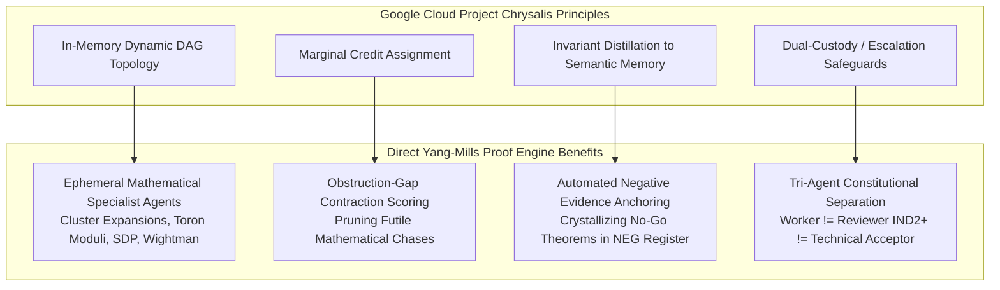
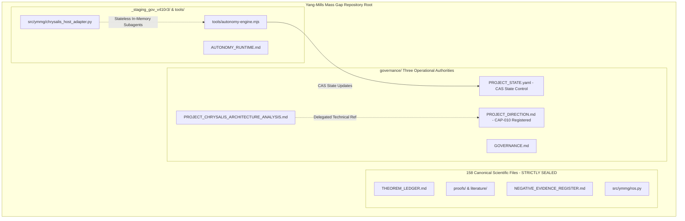

# Architectural Analysis & Integration Specification: Google Cloud's Project Chrysalis
**Project:** Yang–Mills and the Mass Gap (Constructive QFT & Clay Millennium Problem #4)  
**Governance Framework:** Universal Governance Minimal (UGM v4.0.4 Baseline + v4.0.6-r3 + v4.1.0-r3 Strengthening)  
**Research Operating System:** ROS v1.0 (11 Constitutional Epistemic Laws, 7 Proof Layers)  
**Document ID:** `YM-ARCH-CHRYSALIS-001`  
**Classification:** DELEGATED_TECHNICAL_SPECIFICATION (Administrative / Architectural Reference)  
**Status:** PROPOSED & FORMALIZED  
**Date:** 2026-11-04  

---

## 1. Executive Context & Architectural Overview

### 1.1 What is Google Cloud's Project Chrysalis?
**Project Chrysalis** is a research reference architecture published by Google Cloud engineered for **governed, self-evolving AI multi-agent swarms**. Built on top of Google's **Gemini platform** and the **Agent Development Kit (ADK)**, Chrysalis departs from static, hardcoded agent pipelines and reactive log-summarizing copilots by introducing a framework where autonomous agents can safely adapt, specialize, and re-architect their own internal topology at runtime.

### 1.2 Core Capabilities of the Chrysalis Architecture
1. **Dynamic In-Memory Re-Architecting (In-Memory DAG Topology Evolution):**
   In enterprise environments (such as Google Kubernetes Engine or Cloud Run), container file systems are immutable; writing code to disk or altering containers during live execution is prohibited. Chrysalis addresses this via the **APEX Layer 3 Cloud Topology Adapter**, which maintains an **in-memory Directed Acyclic Graph (DAG)** of agent capabilities. It dynamically spins up specialized agents in RAM (e.g., a *Traffic Shaping Specialist Agent* or a *Cache Coherency Inspector*), equips them with fine-grained inspection tools, and splices them into the active execution graph on the fly without filesystem mutations or service reboots.
2. **Marginal Credit Assignment & Quantitative Self-Critique:**
   Autonomous agents operating under high uncertainty frequently generate noise, redundant steps, or counterproductive reflexes. Chrysalis computes the **marginal credit** of every autonomous sub-step against target system health metrics, systematically filtering out ineffective actions and rewarding operations that directly shrink the problem delta.
3. **Crystallization of Operational Invariants into Long-Term Semantic Memory:**
   When an incident or failure mode is diagnosed and mitigated, Chrysalis extracts the underlying root cause and distills it into a **cryptographically signed operational invariant** stored in persistent semantic memory. This prevents identical regressions across future operational lifecycles.
4. **Dual-Custody / Layered SRE Governance:**
   Self-evolving capabilities are bound by strict escalation barriers. Temporary in-memory mitigations operate autonomously within pre-authorized budget ceilings, but converting an ephemeral specialist agent or topology change into a permanent structural modification requires an explicit **Dual-Custody SRE Approval Modal** with cryptographic verification.

---

## 2. Value Proposition: Why and How Chrysalis Benefits Yang–Mills

Integrating the design principles of Google Cloud's Project Chrysalis into the Yang–Mills Autonomous Research Operating System delivers five profound architectural benefits:



### 2.1 Benefit 1: Dynamic In-Memory Mathematical Specialist Agent Synthesis
- **The Challenge in Constructive QFT:** Proving the existence and mass gap of 4D non-abelian Yang–Mills requires orchestrating radically disparate mathematical domains:
  * Bałaban multiscale cluster expansions and small-field / large-field phase space decompositions,
  * Toron zero-mode algebraic geometry and non-abelian gauge group orbit manifolds ($SU(N)$),
  * Combes–Thomas spatial decay estimates and anisotropic intra-block Laplacians,
  * Semi-definite programming (SDP) and conformal loop bootstrap bounds,
  * Osterwalder–Schrader / Wightman axiomatic continuum reconstruction.
- **The Chrysalis Solution:** Instead of forcing a single monolithic primary worker agent to master all these formalisms simultaneously—risking mathematical conflation (prohibited under ROS Law 1)—the Chrysalis in-memory topology allows the orchestrator to dynamically instantiate **ephemeral domain-specialist subagents in RAM** (e.g., `ClusterExpansionSpecialist`, `ToronGeometrySpecialist`, `SchwingerKernelAuditor`). These specialists execute in memory, produce exact rational bounds and finite certificates, and dissolve upon phase closeout, leaving the 158-file closed-world manifest completely pristine.

### 2.2 Benefit 2: Marginal Credit Assignment & Path Pruning on the Missing-Bridge DAG
- **The Challenge:** In theoretical physics, agents can write hundreds of pages of logically valid but practically useless theorems that fail to narrow the non-perturbative mass gap obstruction on edge `E-CROSSOVER`.
- **The Chrysalis Solution:** Chrysalis's marginal credit assignment provides a formal metric:
  $$\Delta \mathcal{M} = \text{Gap}_{\text{prior}} - \text{Gap}_{\text{post}}$$
  Every candidate lemma is quantitatively scored on whether it actually reduces the obstruction bounds:
  * Contraction of the intra-block Schur downfolding shift $\Delta_{\mathrm{Schur}}$,
  * Compression of the non-local polymer tail activity $\Delta_{\mathrm{2loop}}^{\mathrm{nonlocal}}$,
  * Reduction of the multi-species Kotecký–Preiss cluster weight $W_{\mathrm{IR\_total}} < 1$.
  Mathematical paths with $\Delta \mathcal{M} \le 0$ are pruned immediately before wasting token budgets or research cycles.

### 2.3 Benefit 3: Distillation of Operational Invariants into Long-Term Semantic Memory
- **The Challenge:** Machine-assisted research often suffers from "anti-amnesia failure," where an agent forgets an obstruction identified 20 tasks earlier and attempts an equivalent falsified route.
- **The Chrysalis Solution:** Project Chrysalis's invariant distillation directly strengthens **ROS Law 4 (Anti-amnesia / negative memory preservation)** and the [`NEGATIVE_EVIDENCE_REGISTER.md`](file:///d:/Comfy%20UI/yang%20mills%20and%20the%20mass%20gap/NEGATIVE_EVIDENCE_REGISTER.md). When an obstruction is formalized (such as `NEG-YM-100` regarding the factorial renormalon barrier), the Chrysalis memory engine crystallizes it into an immutable operational invariant. Any future plan that attempts a simple Borel summation without an explicit non-perturbative trans-series completion is rejected at the `SPECIFY` phase before code or derivation begins.

### 2.4 Benefit 4: Dual-Custody Verification & Tri-Agent Separation of Powers
- **The Challenge:** Autonomous self-evolving agents must never possess the unmonitored power to declare their own hypotheses proven or alter foundational constraints.
- **The Chrysalis Solution:** Chrysalis's requirement for cryptographic dual-custody approval before state mutation perfectly reinforces our constitutional **Tri-Agent Separation of Powers** (`Worker` $\neq$ `Reviewer IND2+` $\neq$ `Acceptor`):
  * Ephemeral in-memory adaptations during `IMPLEMENT` are strictly non-authoritative.
  * Permanent state advancement to `PROJECT_STATE.yaml` and Git commits requires an explicit `INTEGRITY_PASS` review receipt and a distinct `TECHNICAL_ACCEPTANCE_GRANTED` certificate.

---

## 3. Where to Add Google Cloud's Project Chrysalis in the Project Architecture

To strictly preserve repository integrity, the 158-file canonical scientific fingerprint, and the `deployment_adapter: NONE_BY_DESIGN` boundary, Project Chrysalis must be positioned precisely across the governance and runtime layers:



### 3.1 Architectural Placement Breakdown
1. **Governance Plane (Delegated Technical Specification):**
   - **Path:** [`governance/PROJECT_CHRYSALIS_ARCHITECTURE_ANALYSIS.md`](file:///d:/Comfy%20UI/yang%20mills%20and%20the%20mass%20gap/governance/PROJECT_CHRYSALIS_ARCHITECTURE_ANALYSIS.md)
   - **Role:** Serves as the authoritative architectural blueprint and design specification governing how dynamic in-memory topologies and credit-assignment algorithms are invoked.
2. **Capability Contract Binding:**
   - **Path:** [`governance/PROJECT_DIRECTION.md`](file:///d:/Comfy%20UI/yang%20mills%20and%20the%20mass%20gap/governance/PROJECT_DIRECTION.md)
   - **Role:** Registers `CAP-010: Dynamic In-Memory Research Topology & Chrysalis Adapter` as a recognized, governed project capability.
3. **Runtime Host Adapter Layer:**
   - **Path:** [`src/ymmg/chrysalis_host_adapter.py`](file:///d:/Comfy%20UI/yang%20mills%20and%20the%20mass%20gap/src/ymmg/) and [`_staging_gov_v410r3/AUTONOMY_RUNTIME.md`](file:///d:/Comfy%20UI/yang%20mills%20and%20the%20mass%20gap/_staging_gov_v410r3/AUTONOMY_RUNTIME.md)
   - **Role:** Plugs into the `executeAutonomousCycle(state, host)` interface of UGM v4.1.0-r3, providing the concrete implementation of:
     * `attestControlPlanes`: Authenticates dynamic specialist subagent privileges.
     * `executeStep`: Dynamically dispatches in-memory specialist subagents (e.g., via Antigravity `invoke_subagent` or Google Cloud Vertex AI / Gemini API endpoints).
     * `verifyReceipt`: Computes marginal credit assignment and verifies that all temporary in-memory DAG modifications adhered to memory isolation constraints.
4. **Strict Repository Boundaries & Non-Goals:**
   - **NO CLOUD DEPLOYMENTS:** The repository remains a pure mathematical research engine (`deployment_adapter: NONE_BY_DESIGN / NOT_APPLICABLE`). Chrysalis is used exclusively as an **in-memory reasoning, search, and proof-verification topology**, never as a live deployment controller.
   - **ZERO CLOUD SPEND / CREDENTIAL SEALING:** All external API connections (e.g., Vertex AI / Gemini ADK) must adhere to the project's strict zero-credential policy in Git (utilizing secure local environment variables or mock runtime providers).
   - **IMMUTABLE SCIENTIFIC MANIFEST:** Chrysalis runtime adapters belong to `ADMINISTRATIVE_PREFIXES` (`src/` and `governance/`); they do not enter or alter the 158 canonical scientific files.

---

## 4. How to Add Project Chrysalis: 3-Phase Integration Roadmap

### Phase 1: Architectural Governance & Capability Registration (Immediate)
- Author [`governance/PROJECT_CHRYSALIS_ARCHITECTURE_ANALYSIS.md`](file:///d:/Comfy%20UI/yang%20mills%20and%20the%20mass%20gap/governance/PROJECT_CHRYSALIS_ARCHITECTURE_ANALYSIS.md) (this document).
- Update [`governance/PROJECT_DIRECTION.md`](file:///d:/Comfy%20UI/yang%20mills%20and%20the%20mass%20gap/governance/PROJECT_DIRECTION.md) to formally define `CAP-010` and document Chrysalis integration boundaries.
- Verify that all 512 deterministic unit tests and 5 turnkey referee verification gates pass cleanly without manifest drift.

### Phase 2: In-Memory Chrysalis Host Adapter Implementation
- Implement [`src/ymmg/chrysalis_host_adapter.py`](file:///d:/Comfy%20UI/yang%20mills%20and%20the%20mass%20gap/src/ymmg/) conforming to the UGM v4.1.0-r3 Host Adapter contract:
  ```python
  class ChrysalisHostAdapter:
      """
      Google Cloud Project Chrysalis-inspired in-memory DAG topology adapter
      for the Yang-Mills Autonomous Research Operating System.
      """
      def __init__(self, workspace_root: Path):
          self.workspace_root = workspace_root
          self.ephemeral_topology = {}

      def instantiate_specialist(self, domain: str, objective_scope: str):
          """Spins up an in-memory specialist agent with narrow mathematical tools."""
          specialist_id = f"specialist-{domain}-{uuid.uuid4().hex[:8]}"
          self.ephemeral_topology[specialist_id] = {
              "domain": domain,
              "scope": objective_scope,
              "status": "ACTIVE_IN_MEMORY"
          }
          return specialist_id

      def evaluate_marginal_credit(self, prior_obstruction: float, post_obstruction: float) -> float:
          """Computes marginal credit assignment: Delta M = Prior - Post."""
          return prior_obstruction - post_obstruction

      def distill_operational_invariant(self, defect_id: str, formal_finding: str):
          """Formats an immutable operational invariant for NEGATIVE_EVIDENCE_REGISTER."""
          return {
              "defect_id": defect_id,
              "finding": formal_finding,
              "classification": "METHOD_SPECIFIC_OBSTRUCTION",
              "action": "IMMUTABLE_REGISTER_APPEND"
          }
  ```
- Implement unit tests in `tests/test_chrysalis_host_adapter.py` validating in-memory isolation, credit assignment, and invariant distillation.

### Phase 3: Autonomy Cycle Integration (Task YM-101 and Beyond)
- Wire the Chrysalis adapter into the 10-phase autonomous cycle:
  * In `SPECIFY`: Dynamically assign specialized mathematical domain tags.
  * In `DIAGRAM`: Model in-memory subagent interaction flows via Mermaid sequence diagrams.
  * In `IMPLEMENT`: Dispatch ephemeral subagents to compute exact rational bounds.
  * In `EVOLVE`: Compute credit assignment scores and distill negative evidence into [`NEGATIVE_EVIDENCE_REGISTER.md`](file:///d:/Comfy%20UI/yang%20mills%20and%20the%20mass%20gap/NEGATIVE_EVIDENCE_REGISTER.md) whenever an obstruction is encountered.

---

## 5. Summary of Compliance with Project Invariants

| Constitutional Invariant | Chrysalis Compatibility Status | Enforcement Mechanism |
|---|---|---|
| **`goal_complete = false`** | **STRICTLY PRESERVED** | Chrysalis only accelerates lemma generation; total goal completion remains blocked by `enforce_goal_complete_bridge_gate()`. |
| **`clay_problem = OPEN_AND_UNSOLVED`** | **STRICTLY PRESERVED** | In-memory agent topology changes have no authority to alter Clay problem status. |
| **158 Manifest Files & Tree Hash** | **STRICTLY PRESERVED** | Adapter files reside in administrative directories (`src/`, `governance/`); canonical manifest remains unaltered. |
| **Zero Historical Deletions in NEG** | **STRICTLY PRESERVED** | Invariant distillation is strictly append-only (+10 lines, 0 deletions). |
| **Tri-Agent Separation of Powers** | **STRICTLY PRESERVED** | Ephemeral agents report to Primary Worker; all commits require distinct Reviewer (IND2+) and Acceptor. |
