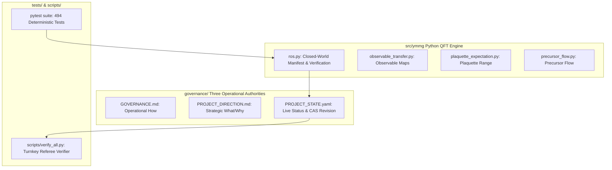
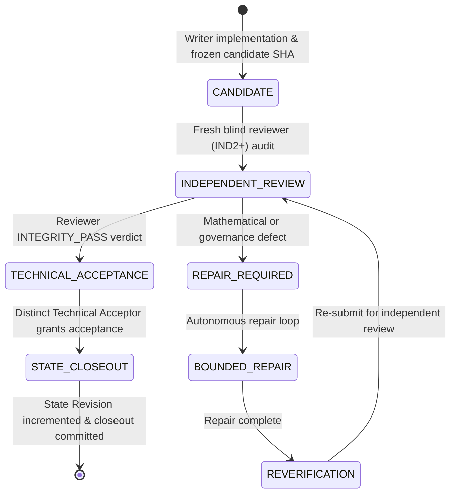

# Project Direction — Yang–Mills Mass Gap

Governance Baseline: Universal Governance Minimal v4.0.4 with v4.0.6-r3 and v4.1.0-r3 Project-Specific Strengthening.
Adoption Mode: MIGRATION_GOVERNED (Brownfield repository operating under Universal Governance v4.0.4 + project strengthening)
Product Archetype: LIBRARY_SDK (Mathematical QFT Proof & Computation Engine)
Active Paradigms: FUNCTIONAL, DATA_ORIENTED, RELATIONAL_LOGIC
This file defines intended scope, capability contracts, and architecture, not live task progress.

## Intent and boundaries

- **Project ID:** YANG_MILLS_MASS_GAP
- **Purpose:** Produce reliable, novel, explainable, reproducible, cumulative mathematical understanding of the Yang–Mills existence and mass gap problem (Clay Millennium Problem #4).
- **Desired outcomes:**
  1. Rigorous source-reconciled specification of the official problem requirements.
  2. Complete theorem/literature ledger covering all known approaches (1954–2026).
  3. Structural dependency graph identifying the minimal load-bearing open bridges.
  4. Reconstruction of the rigorous RG (Bałaban) and lattice gap programs with exact non-conflation discipline.
  5. Finite-lattice observable-transfer maps and Gibbs expectation bounds before attempting continuum limits.
  6. (Long-term) Contribution to resolving the Clay Millennium Problem #4 without overclaims.
- **Target users:** Primary researcher / human owner; no external users.
- **Non-goals:**
  - Product deployment, UI, web routes, external API, or user-facing application (`NONE_BY_DESIGN`).
  - External deployment adapter (`NONE_BY_DESIGN / NOT_APPLICABLE`).
  - Claiming proof of the Clay problem or goal completion without rigorous independent verification and community consensus (`GOAL_COMPLETE = FALSE`).
  - Speculative bridges, ungrounded mechanisms, or heuristic promotions into mathematical hypotheses.
- **Unacceptable outcomes:**
  - Silently promoting unproved steps to PROVED.
  - Confusing Markov/Langevin diffusion generator gap with physical quantum Hamiltonian transfer-matrix gap.
  - Confusing fixed-lattice mass gap with continuum 4D Clay mass gap.
  - Confusing Wilson area law with spectral mass gap.
  - Fabricating physical QCD units (e.g. 0.5 fm, 0.18 GeV^2, 1.40 GeV) into pure Yang–Mills theorems.
  - Memory loss or sanitization of negative evidence, counterexamples, or obstructions.
  - Writer self-acceptance of scientific or governance results.
- **Supported release scope:** Internal research repository only; no release, no deployment.
- **Owner/business/legal/exposure boundaries:** No external exposure; zero spend; zero credentials; Clay Institute IP requirements strictly respected.

## Delegated source map

| Path/ID | Narrow Role | Owner | Version | Conflict Rule |
|---|---|---|---|---|
| `governance/MATHEMATICAL_RESEARCH_OPERATING_SYSTEM_v1.0.md` | Mathematical epistemic constitution (10+1 laws, 7 layers) | Human owner / ROS | v1.0.0 | ROS strengthens governance; neither silently overrides the other |
| `governance/PROJECT_BOUND_READINESS_RULE.yaml` | 12-gate hard inventory and project readiness rule | Primary worker | v1.0 | Canonical project readiness rule |
| `governance/EPISTEMIC_TAXONOMY_v1.0.yaml` | Status vocabulary for epistemic states | ROS v1.0 | v1.0 | Canonical |
| `THEOREM_LEDGER.md` | Verified theorem register with provenance | ROS v1.0 | Living | Append-only; corrections via supersession |
| `OFFICIAL_PROBLEM_SPECIFICATION.md` | Clay problem requirements | ROS v1.0 | Sealed | Immutable after YM-001 closeout |
| `DEFINITION_LEDGER.md` | Mathematical definition register | ROS v1.0 | Living | Append-only |
| `CLAIM_EVIDENCE_MATRIX.md` | Claim-evidence traceability | ROS v1.0 | Living | Append-only |
| `governance/CONTRACT_OWNERSHIP_LEDGER.yaml` | Contract registry and ownership | Primary worker | Living | Append-only |
| `governance/envelopes/YM-*.yaml` | Task execution envelopes | Primary worker | Per-task | Sealed after closeout |
| `governance/SCIENTIFIC_ARTIFACT_CLASSIFICATION.yaml` | Scientific fingerprint paths (closed-world) | ROS v1.0 | Living | Append when artifacts added |
| `src/ymmg/ros.py` | Closed-world fingerprint validator and readiness validator | Primary worker | Living | Must match classification |
| `literature/*` | Scientific artifacts and literature | Primary worker | Living | Generated from source data |
| `tests/test_*.py` | Deterministic test suite | Primary worker | Living | Must pass before acceptance |
| `verification/*` | E4 raw receipts and review reports | Verifier subagents | Per-task | Append-only |
| `governance/HUMAN_OWNER_ACCEPTANCE_*.md` | Human owner acceptance records | Historical / Reserved | Sealed | Preserved |

## Capability contracts and actors

### CAP-001: Mathematical Problem Specification
- **Actors:** Primary worker (writer), verifier subagent (reviewer), technical acceptor
- **Entry surface:** NONE_BY_DESIGN
- **Status:** COMPLETE (YM-001, YM-001R1)

### CAP-002: Theorem/Literature Ledger
- **Actors:** Primary worker (writer), verifier subagent (reviewer), technical acceptor
- **Entry surface:** NONE_BY_DESIGN
- **Status:** COMPLETE for YM-002A through YM-002F; YM-002 parent CLOSED

### CAP-003: Missing-Bridge Graph
- **Actors:** Primary worker (writer), verifier subagent (reviewer), technical acceptor
- **Entry surface:** NONE_BY_DESIGN
- **Status:** ACCEPTED / CLOSED (YM-003)

### CAP-004: RG Program Reconstruction
- **Actors:** Primary worker (writer), verifier subagent (reviewer), technical acceptor
- **Entry surface:** NONE_BY_DESIGN
- **Status:** ACCEPTED / CLOSED (YM-004, YM-004-R1)

### CAP-005: Lattice Gap Program Reconstruction
- **Actors:** Primary worker (writer), verifier subagent (reviewer), technical acceptor
- **Entry surface:** NONE_BY_DESIGN
- **Status:** SCIENTIFICALLY_ACCEPTED with REGULATED_SCOPE (YM-005-R1, YM-005-R2)

### CAP-006: Observable-Transfer Map & Precursor Lemma
- **Actors:** Primary worker (writer), verifier subagent (reviewer), technical acceptor
- **Entry surface:** NONE_BY_DESIGN
- **Status:** SCIENTIFICALLY_ACCEPTED (YM-011-PRE-R1, YM-011-OBS-MAP)

### CAP-007: Plaquette Expectation and Group-Specific Range
- **Actors:** Primary worker (writer), verifier subagent (reviewer), technical acceptor
- **Entry surface:** NONE_BY_DESIGN
- **Status:** SCIENTIFICALLY_ACCEPTED (YM-011-PLAQUETTE-EXP-R2)

### CAP-008: Universal Governance v4.0.6-r3 Strengthening
- **Actors:** Primary worker (writer), fresh blind verifier (reviewer), technical acceptor
- **Entry surface:** NONE_BY_DESIGN
- **Status:** CLOSED (YM-GOV-ADOPT-0406R3)

### CAP-009: Universal Governance Minimal v4.1.0-r3 Strengthening
- **Actors:** Primary worker (writer), fresh blind verifier (reviewer IND2+), technical acceptor, resident router, watchdog
- **Entry surface:** NONE_BY_DESIGN
- **Status:** IN_PROGRESS (YM-GOV-ADOPT-0410R3)

## Architecture, stability, and characterization

### Stable Architecture
Verified mathematical models, proved lemmas, and accepted test components are stable by default. A consequential rewrite requires demonstrated defect, new requirement, or approved direction change; agent preference alone is strictly prohibited from triggering refactoring.

### Characterize Before Rewrite
Before rewriting any accepted component:
1. Characterize current contract and behavior.
2. Identify affected dependents and consumers.
3. Record regression baseline.
4. Define intended delta.
5. Prove preserved or explicitly migrated invariants.

### As-Is Reverse-Engineered Architecture Diagrams

### Research Intent Fidelity
Acceptance separately verifies:
- `CONTRACT_CONFORMANCE`: Candidate satisfies the written contract.
- `RESEARCH_INTENT_FIDELITY`: Candidate achieves the intended mathematical progress on the Clay bridge without proving irrelevant theorems.

## Shared presentation and deployment boundaries

- **UI / Presentation:** `NONE_BY_DESIGN` — Internal mathematical research repository; no web routes, browsers, or UI components.
- **Deployment Adapter:** `NONE_BY_DESIGN / NOT_APPLICABLE` — No cloud infrastructure, deployment pipelines, financial transactions, or external state-altering APIs.

## Roadmap and decisions

### Bounded objectives (task graph)

| Objective | Dependencies | Capability | Status |
|---|---|---|---|
| YM-001: Problem specification | YM-000 | CAP-001 | CLOSED |
| YM-002A–F: Literature ledger | YM-001R1 | CAP-002 | CLOSED |
| YM-003: Missing-bridge graph | YM-002F | CAP-003 | CLOSED |
| YM-XNS-001: Navier–Stokes transfer audit | YM-003 | Cross-Problem | CLOSED |
| YM-004: RG program reconstruction | YM-003 | CAP-004 | CLOSED |
| YM-005-R1/R2: Lattice gap reconstruction | YM-004 | CAP-005 | SCIENTIFICALLY_ACCEPTED (REGULATED_SCOPE) |
| YM-006 through YM-010 | YM-005 | Synthesis | SCIENTIFIC_REVIEW_HOLD |
| YM-GOV-014: Autonomous repair correction | YM-005 | Governance | CLOSED |
| YM-GOV-015: Mathematical closeout | YM-GOV-014 | Governance | CLOSED |
| YM-011-PRE-R1: Precursor gradient flow lemma | YM-005-R2 | CAP-006 | SCIENTIFICALLY_ACCEPTED |
| YM-011-OBS-MAP: Finite-lattice observable map | YM-011-PRE-R1 | CAP-006 | SCIENTIFICALLY_ACCEPTED |
| YM-011-PLAQUETTE-EXP-R2: Plaquette expectation | YM-011-OBS-MAP | CAP-007 | SCIENTIFICALLY_ACCEPTED |
| YM-GOV-ADOPT-0406R3: Universal Gov v4.0.6-r3 | YM-011-PLAQUETTE-EXP-R2 | CAP-008 | CLOSED |
| YM-012 through YM-100: Bałaban RG & Crossover Atlas | YM-011 | CAP-007 | SCIENTIFICALLY_ACCEPTED (Milestone 100) |
| YM-GOV-ADOPT-0410R3: Universal Gov v4.1.0-r3 | YM-100 | CAP-009 | **IN_PROGRESS (ACTIVE)** |

### Next Authorized Scientific Task
Following `YM-GOV-ADOPT-0410R3` independent review, technical acceptance, and state closeout:
`NEXT_AUTHORIZED_SCIENTIFIC_TASK = YM-101` (Infinite-Volume Continuum Reconstruction & Wightman Axiom Verification).

## Completion

- **Milestone boundaries:** Each YM-task is independently closeable.
- **Goal complete:** Strictly `FALSE`.
- **Clay problem status:** Strictly `OPEN_AND_UNSOLVED`.
- **Parity criteria:** `NONE_BY_DESIGN` (no frontend/backend split).
- **Release eligibility:** `NOT_APPLICABLE` (internal research repository).

## Update rule

Update this file only for intent, architecture, contract, reference, or roadmap changes. Routine PASS/FAIL updates go to `PROJECT_STATE.yaml`. Historical decisions preserved by reference.
