# ANALOGUE DEPENDENCY GRAPH (YM-002D)

```mermaid
flowchart TD
    subgraph S1["Program D1: Rigorous 2D Yang–Mills"]
        DSL_2D["THM-YM-0031: Driver-Sengupta-Lévy 2D YM<br/>[JFA / Ann Phys / Mem AMS]<br/>(RIGOROUS_MATHEMATICAL_CONSTRUCTION)"]
    end

    subgraph S2["Program D2: Large-N 2D Lattice"]
        GWW_80["THM-YM-0032: Gross-Witten-Wadia 3rd-Order Transition<br/>[PRD 21 / PLB 93]<br/>(EXACTLY_SOLVABLE_PHYSICS_MODEL)"]
    end

    subgraph S3["Program D3: 2D Schwinger Model"]
        SCH_62["THM-YM-0033: Schwinger 2D Mass Generation<br/>[Phys Rev 128 / Ann Phys 68]<br/>(EXACTLY_SOLVABLE_PHYSICS_MODEL)"]
    end

    subgraph S4["Program D4: 3D Semiclassical Monopoles"]
        POL_77["THM-YM-0034: Polyakov 3D Monopole Gas<br/>[Nucl Phys B 120]<br/>(SEMICLASSICAL_MECHANISM)"]
    end

    subgraph S5["Program D5: Seiberg–Witten N=2"]
        SW_94["THM-YM-0035: Seiberg-Witten Monopole Condensation<br/>[Nucl Phys B 426/431]<br/>(EXACT_SUPERSYMMETRIC_PHYSICS_RESULT)"]
    end

    subgraph S6["Program D6: N=1 Super Yang–Mills"]
        NSVZ_83["THM-YM-0036: NSVZ Beta Function & Gluino Condensation<br/>[Nucl Phys B 229 / 202]<br/>(EXACT_SUPERSYMMETRIC_PHYSICS_RESULT)"]
    end

    subgraph S7["Program D7: N=4 Super Yang–Mills"]
        MBSS_83["THM-YM-0037: Mandelstam N=4 All-Orders Finiteness<br/>[Nucl Phys B 213 / 121]<br/>(SUPERCONFORMAL_QFT_WITH_EXACT_PROTECTED_AND_ALL_ORDER_RESULTS)"]
    end

    subgraph S8["Program D8: Gauge-Higgs Theories"]
        FS_79["THM-YM-0038: Fradkin-Shenker Analyticity & Higgs<br/>[PRD 19 / PRL 13]<br/>(GAUGE_HIGGS_LATTICE_ANALYTICITY_AND_HIGGS_MASS_RESULT)"]
    end

    subgraph S9["Program D9: Classical Massive Vector"]
        PRO_36["THM-YM-0039: Proca-Stueckelberg Vector Mass<br/>[J Phys Radium 7 / HPA 11]<br/>(PROCA_EXPLICIT_MASS_STUECKELBERG_GAUGE_REFORMULATION)"]
    end

    subgraph S10["Program D10: Holographic Conjectures"]
        WIT_98["THM-YM-0040: Witten Holographic Confinement<br/>[ATMP 2 / PRL 88]<br/>(HOLOGRAPHIC_CONJECTURAL_ANALOGUE)"]
    end

    subgraph TARGET["Pure 4D Quantum Yang–Mills Target"]
        CLAY_TARGET["Clay Millennium 4D Pure Yang–Mills Mass Gap<br/>[UNSOLVED / CLAY_SUFFICIENT: NO]"]
    end

    DSL_2D -. "TRANSFER_BARRIER: Zero propagating transverse gluons (2-2=0)" .-> CLAY_TARGET
    GWW_80 -. "TRANSFER_BARRIER: Planar saddle point suppresses non-planar fluctuations" .-> CLAY_TARGET
    SCH_62 -. "TRANSFER_BARRIER: Requires 2D Abelian kinematics & fundamental Dirac fermions" .-> CLAY_TARGET
    POL_77 -. "TRANSFER_BARRIER: Requires adjoint Higgs VEV & 3D pointlike instantons" .-> CLAY_TARGET
    SW_94 -. "TRANSFER_BARRIER: Requires N=2 SUSY, holomorphic prepotential & scalar moduli" .-> CLAY_TARGET
    NSVZ_83 -. "TRANSFER_BARRIER: Requires N=1 SUSY, adjoint gluinos & R-symmetry" .-> CLAY_TARGET
    MBSS_83 -. "TRANSFER_BARRIER: beta=0 identically, Delta=0 massless continuous spectrum" .-> CLAY_TARGET
    FS_79 -. "TRANSFER_BARRIER: Mass scale from fundamental scalar VEV <Phi> != 0" .-> CLAY_TARGET
    PRO_36 -. "TRANSFER_BARRIER: Bare mass violates non-Abelian gauge symmetry & renormalizability" .-> CLAY_TARGET
    WIT_98 -. "TRANSFER_BARRIER: Relies on unproved AdS/CFT duality, N->inf & lambda>>1" .-> CLAY_TARGET
```

## Explicit Edge & Transfer Barrier Justifications

1. **`THM-YM-0031 -> CLAY_TARGET`**: Driver, Sengupta, and Lévy rigorously construct 2D Yang–Mills measures, but 2D spacetime has zero local propagating gluonic degrees of freedom ($2 - 2 = 0$), bypassing the non-linear local UV singularities of 4D Yang–Mills.
2. **`THM-YM-0032 -> CLAY_TARGET`**: Gross, Witten, and Wadia solve 2D lattice gauge theory in the large-$N$ limit via planar saddle point, but the solution suppresses $1/N$ non-planar fluctuations and does not describe 4D continuum scaling.
3. **`THM-YM-0033 -> CLAY_TARGET`**: Schwinger and Lowenstein–Swieca solve 2D QED, generating a photon mass from the 2D fermion chiral anomaly, but pure 4D Yang–Mills has no fundamental fermions and no exact 4D bosonization.
4. **`THM-YM-0034 -> CLAY_TARGET`**: Polyakov derives confinement in 3D Georgi–Glashow from a dilute monopole gas, but the mechanism requires an adjoint Higgs field $v \gg g^2$ and pointlike 3D instantons.
5. **`THM-YM-0035 -> CLAY_TARGET`**: Seiberg and Witten prove dual Meissner confinement in $\mathcal{N}=2$ SYM upon $\mathcal{N}=1$ mass deformation, but the control rests entirely on extended supersymmetry and holomorphic moduli curves unavailable in pure Yang–Mills.
6. **`THM-YM-0036 -> CLAY_TARGET`**: Novikov et al. and Witten compute the exact NSVZ beta function and gluino condensation in $\mathcal{N}=1$ SYM, but pure Yang–Mills has no gluinos, no $R$-symmetry, and zero supersymmetry.
7. **`THM-YM-0037 -> CLAY_TARGET`**: N=4 SYM has exact all-order/protected results within a superconformal QFT, but its conformal massless spectrum ($\Delta = 0$) and extra supersymmetric matter do not provide a complete pure-YM solution.
8. **`THM-YM-0038 -> CLAY_TARGET`**: Fradkin and Shenker prove analyticity along a specified path in a lattice gauge-Higgs model with fundamental scalars; this is distinct from the Higgs mass mechanism and neither supplies a pure-YM dynamical gap.
9. **`THM-YM-0039 -> CLAY_TARGET`**: Proca inserts an explicit vector mass, while Stueckelberg provides a compensating-field Abelian reformulation. Neither is dynamical pure-YM mass generation; non-Abelian extensions require separate consistency analysis.
10. **`THM-YM-0040 -> CLAY_TARGET`**: Witten and Polchinski–Strassler derive glueball spectra from supergravity on warped backgrounds, but the derivation relies on unproved holographic duality conjectures, $N 	o \infty$, and large 't Hooft coupling $\lambda \gg 1$.
