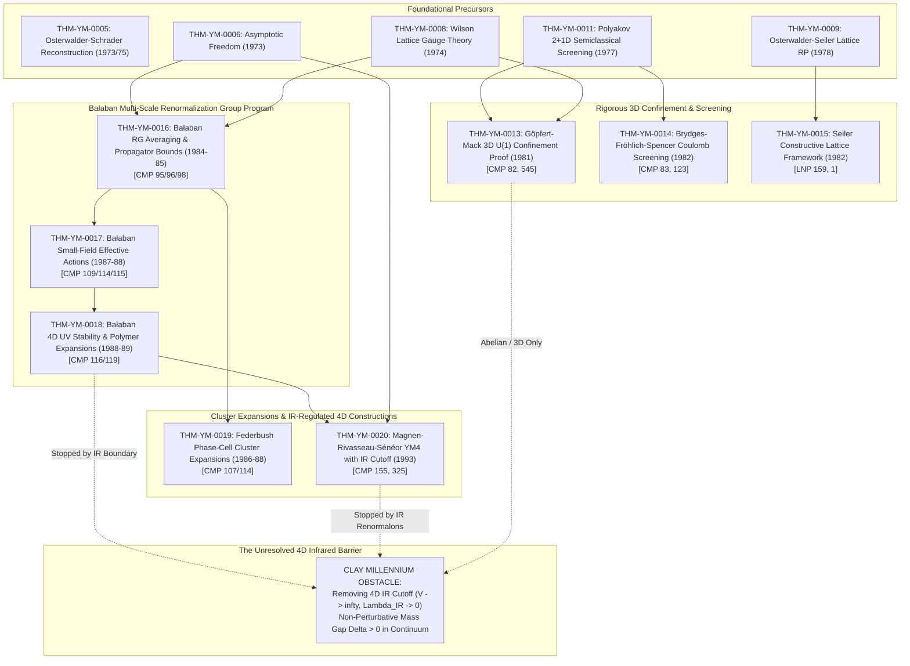

# CONSTRUCTIVE DEPENDENCY GRAPH (1980–2000)

## Logical and Technical Prerequisite Structure

## Explicit Edge Justifications

1. **`THM-YM-0011 -> THM-YM-0013`**: Göpfert and Mack (1981) mathematically proved the Polyakov 1977 semiclassical monopole Debye screening mechanism for 3D $U(1)$ lattice gauge theory with Villain action (*Comm. Math. Phys.* 82, 545).
2. **`THM-YM-0011 -> THM-YM-0014`**: Brydges, Fröhlich, and Spencer (1982) provided rigorous mathematical bounds for 3D Coulomb / dipole gases underpinning Debye screening (*Comm. Math. Phys.* 83, 123).
3. **`THM-YM-0009 -> THM-YM-0015`**: Seiler (1982) systematically synthesized Osterwalder–Seiler reflection positivity, transfer matrix spectral theory, and cluster expansions for general lattice gauge models (*LNP* 159, 1).
4. **`THM-YM-0006 & THM-YM-0008 -> THM-YM-0016`**: Bałaban's RG averaging operations combine Wilson lattice link variables with asymptotic freedom running across scale steps (*Comm. Math. Phys.* 95, 419; 98, 17).
5. **`THM-YM-0016 -> THM-YM-0017`**: Bałaban's small-field effective action inductively applies the propagator bounds and gauge-fixing operations developed in 1984–1985 (*Comm. Math. Phys.* 109, 249; 114, 627).
6. **`THM-YM-0017 -> THM-YM-0018`**: Bałaban's full 4D UV stability theorem combines the small-field effective actions with convergent polymer expansions for large-field deviations (*Comm. Math. Phys.* 116, 1; 119, 243).
7. **`THM-YM-0016 -> THM-YM-0019`**: Federbush's phase-cell cluster expansion builds upon multi-scale lattice block gauge operations (*Comm. Math. Phys.* 107, 319; 114, 317).
8. **`THM-YM-0018 & THM-YM-0006 -> THM-YM-0020`**: Magnen, Rivasseau, and Sénéor rely on UV asymptotic stability techniques to construct 4D Yang–Mills Schwinger distributions in the presence of an infrared mass cutoff (*Comm. Math. Phys.* 155, 325).
9. **`THM-YM-0018 / THM-YM-0020 -.-> CLAY_BARRIER`**: Neither Bałaban nor Magnen–Rivasseau–Sénéor could take the infinite-volume / zero-IR-cutoff limit in 4D continuum due to the absence of non-perturbative control over infrared confinement and the mass gap.
