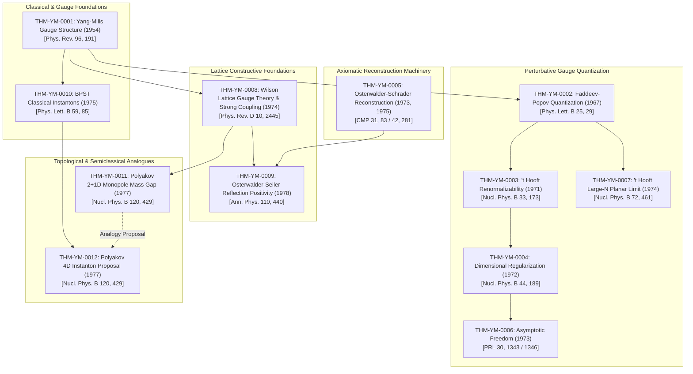

# FOUNDATIONAL DEPENDENCY GRAPH (1954–1980)

## Logical and Technical Prerequisite Structure

## Explicit Edge Justifications

1. **`THM-YM-0001 -> THM-YM-0002`**: Faddeev–Popov functional integration explicitly quantizes the classical non-Abelian connection and curvature formulated by Yang and Mills (*Phys. Lett. B* 25, 29).
2. **`THM-YM-0002 -> THM-YM-0003`**: Perturbative renormalizability of non-Abelian gauge fields relies essentially on the ghost-extended action and Slavnov–Taylor identities proved via Faddeev–Popov quantization (*Nucl. Phys. B* 33, 173).
3. **`THM-YM-0003 -> THM-YM-0004`**: Dimensional regularization was developed by 't Hooft and Veltman to provide an explicit gauge-invariant regulator preserving the Ward identities required by 't Hooft's renormalization proof (*Nucl. Phys. B* 44, 189).
4. **`THM-YM-0004 -> THM-YM-0006`**: The 1-loop negative beta function of Gross–Wilczek and Politzer is computed directly using the gauge-invariant Feynman rules and renormalization constants established in the 't Hooft–Veltman framework (*Phys. Rev. Lett.* 30, 1343).
5. **`THM-YM-0002 -> THM-YM-0007`**: The $1/N$ expansion reorganizes the perturbative Feynman diagrams generated by Faddeev–Popov quantization (*Nucl. Phys. B* 72, 461).
6. **`THM-YM-0001 -> THM-YM-0008`**: Wilson formulated lattice gauge theory by discretizing the classical continuous Yang–Mills action while preserving exact local gauge symmetry on link variables (*Phys. Rev. D* 10, 2445).
7. **`THM-YM-0008 + THM-YM-0005 -> THM-YM-0009`**: Osterwalder and Seiler applied the Osterwalder–Schrader reflection positivity concept directly to the Wilson lattice action, proving existence of the transfer matrix and positive-definite Hilbert space (*Ann. Phys.* 110, 440).
8. **`THM-YM-0001 -> THM-YM-0010`**: BPST instantons are exact classical solutions to the Euclidean Yang–Mills field equations (*Phys. Lett. B* 59, 85).
9. **`THM-YM-0008 -> THM-YM-0011`**: Polyakov's 2+1D compact QED confinement proof analyzes the compact lattice $U(1)$ gauge theory defined in the Wilson formulation (*Nucl. Phys. B* 120, 429).
10. **`THM-YM-0010 -> THM-YM-0012`**: Polyakov's 4D semiclassical instanton proposal is built on the BPST classical pseudoparticle solutions (*Nucl. Phys. B* 120, 429).
