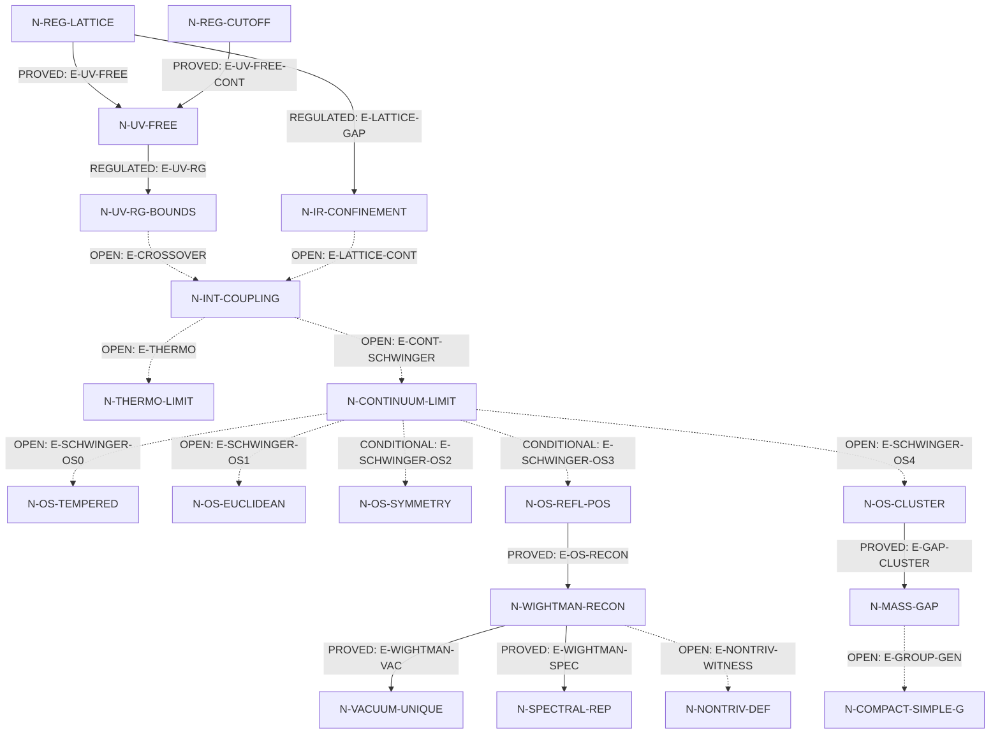

# MISSING-BRIDGE GRAPH (YM-003)

## 1. Executive Summary & Graph Topology

This document provides the canonical topological representation of the missing bridges
and verified theorem coverage connecting regulated gauge theories to the full Clay Millennium target.

### Directed Graph Representation (Mermaid)

## 2. Node Semantic Registry

| Node ID | Domain / Branch | Semantic Definition | Target / Route Relevance |
|---|---|---|---|
| `N-REG-LATTICE` | Regularization | Wilson lattice gauge theory with compact gauge group $G$ at lattice spacing $a > 0$. | Entry point for lattice constructive route. |
| `N-REG-CUTOFF` | Regularization | Continuum gauge field with UV cutoff $\Lambda < \infty$ or IR cutoff $\mu > 0$. | Entry point for continuous RG flow / SPDE route. |
| `N-UV-FREE` | UV Asymptotic Freedom | Running coupling $g_k \to 0$ logarithmically as energy scale $k \to \infty$ ($a \to 0$). | Required UV asymptotic freedom behavior. |
| `N-UV-RG-BOUNDS` | Multiscale RG | Uniform small-field multiscale bounds in finite volume (Bałaban / Federbush). | Foundation of rigorous UV stability. |
| `N-INT-COUPLING` | Nonperturbative Crossover | Strong effective coupling regime $g_k \sim 1$ (the unbridged non-meeting window). | Critical bottleneck region. |
| `N-IR-CONFINEMENT` | IR Lattice Phase | Strong-coupling lattice area-law confinement and cluster decay (Wilson / Shen–Zhu–Zhu). | Rigorous fixed-lattice infrared gap. |
| `N-THERMO-LIMIT` | Thermodynamic Limit | Infinite volume limit $V \to \infty$ with uniform volume-independent bounds. | Required for infinite-volume QFT. |
| `N-CONTINUUM-LIMIT` | Continuum Limit | Continuum limit $a \to 0$ of Schwinger functions $S_n \in \mathcal{S}'((\mathbb{R}^4)^n)$. | Primary existence target. |
| `N-OS-TEMPERED` | OS Axioms | OS0: Tempered distribution bounds on Schwinger functions. | Prerequisite for OS reconstruction. |
| `N-OS-EUCLIDEAN` | OS Axioms | OS1: Full Euclidean covariance under $\mathrm{O}(4) \ltimes \mathbb{R}^4$. | Restoration of spacetime rotation invariance. |
| `N-OS-SYMMETRY` | OS Axioms | OS2: Permutation symmetry under coordinate exchange. | Fundamental Euclidean property. |
| `N-OS-REFL-POS` | OS Axioms | OS3: Reflection positivity ($\Theta$-positivity) with respect to time-reflection. | Necessary for positive Hilbert space metric. |
| `N-OS-CLUSTER` | OS Axioms | OS4: Exponential clustering with rate $\Delta > 0$. | Direct Euclidean witness of spectral gap. |
| `N-WIGHTMAN-RECON` | Relativistic QFT | Reconstructed Wightman QFT on physical Hilbert space $\mathcal{H}$ with $U(a, \Lambda)$. | Official Clay existence requirement. |
| `N-VACUUM-UNIQUE` | Vacuum Sector | Unique, Poincaré-invariant physical vacuum $\Omega$ with $H \Omega = 0$. | Normalized ground state. |
| `N-SPECTRAL-REP` | Spectral Representation | Joint energy-momentum spectrum $\operatorname{Spec}(H, \vec{P}) \subseteq \bar{V}_+$. | Relativistic stability. |
| `N-NONTRIV-DEF` | Non-Triviality | Local gauge-invariant operators generating states non-reducible to free fields. | Official Clay non-triviality condition. |
| `N-MASS-GAP` | Mass Gap | Strict positive spectral isolation $\operatorname{Spec}(H|_{{\mathcal{H}_0^\perp}}) \subseteq [\Delta, \infty)$ with $\Delta > 0$. | Official Clay mass gap condition. |
| `N-COMPACT-SIMPLE-G` | Group Universality | Construction and uniform gap for arbitrary compact simple Lie group $G$. | Universal group requirement. |

## 3. Summary of Graph-Theoretic Coverage

- **Total Directed Edges:** 19
- **Proved Structural Theorems:** 6
- **Regulated / Finite-Regime Theorems:** 2
- **Conditional Theorems:** 2
- **Open Gaps / Bottlenecks:** 9
