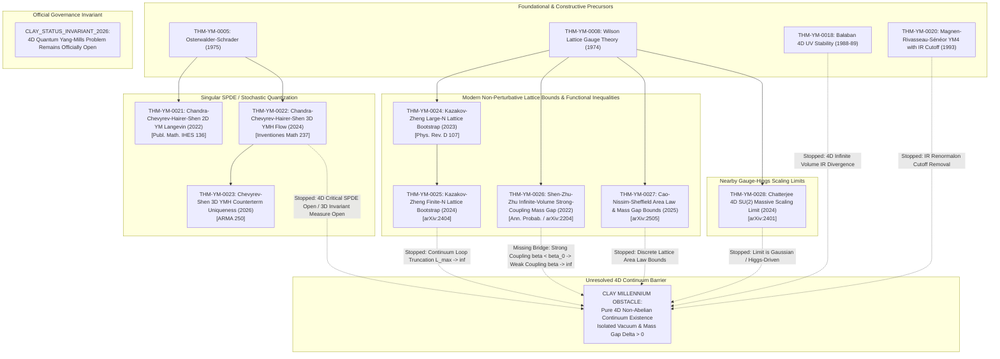

# MODERN DEPENDENCY GRAPH (2000–2026)

## Logical and Technical Prerequisite Structure

## Explicit Edge Justifications

1. **`THM-YM-0005 -> THM-YM-0021`**: Chandra, Chevyrev, Hairer, and Shen build upon Euclidean reflection positivity and OS measure formulations to construct the 2D invariant Langevin dynamic (*Publ. Math. IHÉS* 136, 1).
2. **`THM-YM-0005 -> THM-YM-0022`**: CCHS use Euclidean regularity structures and gauge orbit geometry to construct the local 3D stochastic flow (*Invent. Math.* 237, 85).
3. **`THM-YM-0022 -> THM-YM-0023`**: Chevyrev and Shen prove canonical uniqueness of the stochastic renormalization counterterm group for the 3D singular SPDE developed in CCHS 2024 (*ARMA* 250, art. 11).
4. **`THM-YM-0008 -> THM-YM-0024`**: Kazakov and Zheng derive large-N bootstrap inequalities directly from Wilson's discrete lattice gauge action combined with planar loop equations (*Phys. Rev. D* 107, L051501).
5. **`THM-YM-0024 -> THM-YM-0025`**: Kazakov and Zheng extend the planar bootstrap to finite-N ($SU(2)$) gauge theories using trace relations and finite-N Gram matrices (*arXiv:2404.16925*).
6. **`THM-YM-0008 -> THM-YM-0026`**: Shen, Zhu, and Zhu construct the infinite-volume Gibbs measure and prove Poincaré/log-Sobolev inequalities starting from Wilson's lattice action at strong coupling (*Ann. Probab.* / *arXiv:2204.12737*).
7. **`THM-YM-0008 -> THM-YM-0027`**: Cao, Nissim, and Sheffield expand Wilson loop area-law bounds using dynamical lattice methods (*arXiv:2505.16585*).
8. **`THM-YM-0008 -> THM-YM-0028`**: Chatterjee establishes scaling limits starting from Wilson's 4D lattice action coupled to fundamental scalar Higgs fields (*arXiv:2401.10507*).
9. **`SZZ_22 -.-> CLAY_BARRIER`**: Shen–Zhu–Zhu rigorously proves an infinite-volume mass gap on the lattice at strong coupling ($eta < eta_0$). The decisive missing bridge is connecting this strong-coupling regime to the weak-coupling continuum trajectory ($eta 	o \infty, g 	o 0, a 	o 0$).
