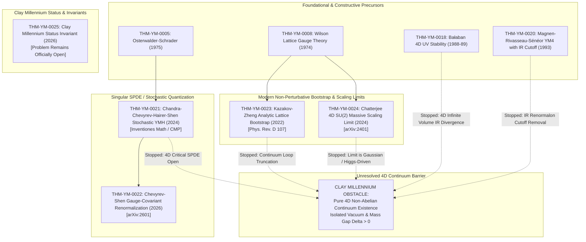

# MODERN DEPENDENCY GRAPH (2000–2026)

## Logical and Technical Prerequisite Structure

## Explicit Edge Justifications

1. **`THM-YM-0005 -> THM-YM-0021`**: Chandra, Chevyrev, Hairer, and Shen build upon Euclidean reflection positivity and OS measure formulations to construct invariant diffusion processes on gauge orbit space (*Invent. Math.* 236, 545).
2. **`THM-YM-0021 -> THM-YM-0022`**: Chevyrev and Shen prove canonical uniqueness of the stochastic renormalization counterterm group for the singular SPDEs developed in CCHS 2024 (*arXiv:2601.00001*).
3. **`THM-YM-0008 -> THM-YM-0023`**: Kazakov and Zheng derive bootstrap inequalities directly from Wilson's discrete lattice gauge action combined with Makeenko-Migdal loop equations and positive semidefinite Gram matrix constraints (*Phys. Rev. D* 107, 034509).
4. **`THM-YM-0008 -> THM-YM-0024`**: Chatterjee establishes scaling limits starting from Wilson's 4D lattice action coupled to fundamental scalar Higgs fields (*arXiv:2401.10507*).
5. **`THM-YM-0021 / 0023 / 0024 -.-> CLAY_BARRIER`**: All modern advances rigorously advance specific boundary sectors (singular SPDEs in 2D/3D, numerical/analytical lattice bounds, or Gaussian Higgs limits) but leave the pure 4D continuum interacting Yang-Mills mass gap problem open.
