# Task YM-012: E-CROSSOVER Fine-Grained Dependency DAG

- **TASK_ID:** `YM-012-DAG`
- **OBJECTIVE:** Decompose the missing-bridge edge `E-CROSSOVER` (`N-UV-RG-BOUNDS -> N-INT-COUPLING`) into an explicit, non-compounded dependency DAG connecting `YM-011` UV control to continuum mass-gap requirements.
- **GOVERNANCE_TIER:** `R2` / `R3`
- **DATE:** 2026-10-02
- **INVARIANTS:**
  - `goal_complete: false`
  - `clay_problem: OPEN_AND_UNSOLVED`
  - `P3: OPEN` (Continuum Non-Perturbative Control)
  - `YM-011_status: SCIENTIFICALLY_ACCEPTED (WITH_REGULATED_UV_SCOPE)`

---

## 1. Structural Overview & Purpose

Task `YM-011` established Theorem `YM-011-L1`: the regulated multiscale ultraviolet scale-transfer bridge for gauge-invariant Wilson loop observables across dyadic lattices with flow matching $\alpha(t) = 2(d-1)t/a^2$. That result proves geometric convergence across the UV hierarchy $\sum_{j=0}^{k-1} 2^{-j} g_j^2 \le 4 g_0^2$, but halts strictly at the crossover boundary $a_{\mathrm{cross}}$ where running coupling $g_k \sim 1$ (`NEG-YM-011-TRANSFER-2`).

To determine whether any rigorous mathematical mechanism can bridge from this UV foundation toward the continuum mass gap without unproved leaps, this document constructs the fine-grained structural dependency DAG.

Every missing implication between the output of `YM-011` and the ultimate Clay Millennium Problem requirements is decomposed into a distinct directed edge. No two distinct mathematical steps are combined into an assumed single arrow.

---

## 2. The 8-Node Fine-Grained Pipeline

```text
[Node 1: N-UV-RG-BOUNDS]
         │
         ▼  (Edge 1: E-CROSSOVER-WINDOW)
[Node 2: N-INT-CROSSOVER]
         │
         ▼  (Edge 2: E-EFF-NONPERT-DESC)
[Node 3: N-EFF-NONPERT]
         │
         ▼  (Edge 3: E-UNIF-CUTOFF-EST)
[Node 4: N-UNIF-BOUNDS]
         │
         ▼  (Edge 4: E-CONT-SCHWINGER-LIM)
[Node 5: N-SCHWINGER-LIMIT]
         │
         ▼  (Edge 5: E-REFL-POS-OS3)
[Node 6: N-REFL-POS]
         │
         ▼  (Edge 6: E-EXP-CLUSTERING)
[Node 7: N-CLUST-SPECTRAL]
         │
         ▼  (Edge 7: E-SPECTRAL-MASS-GAP)
[Node 8: N-MASS-GAP]
```

---

## 3. Node Specifications

### Node 1: `N-UV-RG-BOUNDS`
- **Physical/Mathematical Object:** Multiscale sequence of effective actions and gauge-invariant loop observables $\{\langle W_{\Lambda_k}(C) \rangle_{\mu_k^{\mathrm{eff}}}\}_{k=0}^{k_{\mathrm{cross}}}$ on dyadic lattices $\Lambda_k$ of spacing $a_k = 2^k a_0$.
- **Established Status:** **`PROVED (REGULATED_UV_SCOPE)`** via Theorem `YM-011-L1` and Bałaban (1985–1989).
- **Domain of Validity:** Bare coupling $g_0 \le g_* \approx 0.8$, effective coupling $g_k \le g_*$, lattice spacings $a_k \le a_{\mathrm{cross}} \approx 0.15\text{--}0.20\text{ fm}$.
- **Key Property:** Single-scale discrepancy $|\langle W_{\Lambda_{j+1}} \rangle - \langle W_{\Lambda_j, t} \rangle| \le C \frac{|C|}{a_j} g_j^2$ with multiscale geometric convergence.

---

### Node 2: `N-INT-CROSSOVER`
- **Physical/Mathematical Object:** Functional measure and loop correlation functions in the intermediate-coupling window where $g(a) \sim 1$ (corresponding to $\beta = 2N/g^2 \in [\beta_0, 2N/g_*^2]$).
- **Established Status:** **`OPEN`**
- **Domain of Validity:** Scales $a \in [a_{\mathrm{cross}}, a_{\mathrm{strong}}] \approx [0.20, 0.50\text{ fm}]$, coupling $g \approx 0.8\text{--}2.5$.
- **Mathematical Characteristic:** Boundary where small-field perturbation theory loses contractivity ($\|A\| \le g^{-\gamma}$ no longer confines fluctuations) and high-temperature character polymer expansions diverge ($a_F(\beta) > 1/C_{\mathrm{geom}}$).

---

### Node 3: `N-EFF-NONPERT`
- **Physical/Mathematical Object:** Coarse-scale effective functional measure $\mu_{\mathrm{eff}}^{\mathrm{IR}}$ or loop-space representation incorporating non-perturbative degrees of freedom (e.g. condensed center vortex sheets, dual magnetic flux tubes, or non-perturbative screening masses).
- **Established Status:** **`OPEN`**
- **Domain of Validity:** Scales $a \ge a_{\mathrm{strong}} \approx 0.50\text{ fm}$, where the effective coupling enters the strong-coupling domain $\beta_{\mathrm{eff}} \le \beta_0$.
- **Mathematical Characteristic:** Must be demonstrably connected to the UV effective measure $\mu_{\mathrm{UV}}$ through a rigorous coarse-graining transfer operator $\mathcal{T}_{\mathrm{cross}}$.

---

### Node 4: `N-UNIF-BOUNDS`
- **Physical/Mathematical Object:** Cutoff-independent and volume-independent uniform bounds on regularized correlation functions and Wilson loop expectations:
  $$\sup_{a > 0} \sup_{V < \infty} |\langle \mathcal{O}_1(x_1) \cdots \mathcal{O}_n(x_n) \rangle_{\mu_{a, V}}| \le C_n(x_1, \dots, x_n) < \infty$$
  for mutually non-coincident points $x_i \ne x_j$.
- **Established Status:** **`OPEN`**
- **Mathematical Characteristic:** Prevents pathological blow-up or trivialization ($S_n \to 0$ or $S_n \to \infty$) as the bare lattice cutoff $a \to 0$ is removed under asymptotically free bare coupling $g_0(a) \to 0$.

---

### Node 5: `N-SCHWINGER-LIMIT`
- **Physical/Mathematical Object:** The family of continuum Euclidean Schwinger distributions $\{S_n\}_{n=1}^\infty \in \mathcal{S}'((\mathbb{R}^4)^n)$ constructed as the rigorous weak-* limit of the lattice regularized expectation values as $a \to 0$ and $V \to \infty$.
- **Established Status:** **`OPEN`** (Corresponds to Clay Millennium Problem Step 1: Existence of 4D quantum Yang–Mills theory).
- **Axiomatic Requirements Satisfied at this Node:**
  - **OS0 (Temperedness):** $S_n \in \mathcal{S}'((\mathbb{R}^4)^n)$.
  - **OS1 (Euclidean Covariance):** Invariance under the Euclidean group $\mathrm{ISO}(4) = \mathbb{R}^4 \rtimes \mathrm{SO}(4)$.
  - **OS2 (Permutation Symmetry):** $S_n(x_{\pi(1)}, \dots, x_{\pi(n)}) = S_n(x_1, \dots, x_n)$ for Bose fields.

---

### Node 6: `N-REFL-POS`
- **Physical/Mathematical Object:** Osterwalder–Schrader Reflection Positivity (OS3) on the continuum Schwinger functions across Euclidean time hyperplanes:
  $$\sum_{j, k=0}^M S_{j+k}(\Theta f_j \otimes f_k) \ge 0$$
  for all test sequences $\{f_k\}_{k=0}^M$ supported at positive Euclidean times $x_{k, 0} > 0$, where $\Theta(x_0, \mathbf{x}) = (-x_0, \mathbf{x})$.
- **Established Status:** **`OPEN`**
- **Reconstruction Consequence:** Unlocks Osterwalder–Schrader / GNS reconstruction of the physical Hilbert space $\mathcal{H}_{\mathrm{phys}}$ with positive-definite metric, vacuum state $\Omega \in \mathcal{H}_{\mathrm{phys}}$, and self-adjoint positive Hamiltonian $H \ge 0$.

---

### Node 7: `N-CLUST-SPECTRAL`
- **Physical/Mathematical Object:** Exponential clustering of gauge-invariant Schwinger functions at large Euclidean time separations:
  $$|S_2(x, y) - S_1(x)S_1(y)| \le C e^{-m |x_0 - y_0|} \quad \text{as } |x_0 - y_0| \to \infty$$
  for a strictly positive mass parameter $m > 0$ that is independent of any regularization cutoff.
- **Established Status:** **`OPEN`**
- **Mathematical Characteristic:** Unlocks OS4 (Ergodicity/Cluster Decomposition) and guarantees that the vacuum $\Omega$ is unique and isolated.

---

### Node 8: `N-MASS-GAP`
- **Physical/Mathematical Object:** The spectrum of the continuum Hamiltonian operator $H$ on the physical Hilbert space $\mathcal{H}_{\mathrm{phys}}$ satisfies:
  $$\sigma(H) \subset \{0\} \cup [\Delta, \infty) \quad \text{with } \Delta = m > 0$$
  where $H\Omega = 0$ is the unique ground state and $\Delta > 0$ is a strictly positive energy gap in physical mass units.
- **Established Status:** **`OPEN`** (Corresponds to Clay Millennium Problem Step 2: Strict positivity of the mass gap).

---

## 4. Fine-Grained Directed Edge Breakdown

### Edge 1: `E-CROSSOVER-WINDOW`
- **Source:** `N-UV-RG-BOUNDS`
- **Target:** `N-INT-CROSSOVER`
- **Proposition:** Non-perturbative continuation of effective gauge measure $\mu_k$ across the intermediate-coupling window $g_k \in [g_*, g_{\mathrm{strong}}]$ ($g_k \approx 0.8\text{--}2.5$).
- **Required Hypotheses:** Mathematical control of fluctuation integration when small-field Gaussian contractivity $\kappa_{\mathrm{BF}} < 1$ fails and large-field polymer activity $e^{-c/g^2}$ is non-negligible ($O(1)$).
- **Status:** **`OPEN`**
- **Primary Barrier:** Simultaneous failure of perturbation theory and cluster expansion (`NEG-YM-011-TRANSFER-2`).

---

### Edge 2: `E-EFF-NONPERT-DESC`
- **Source:** `N-INT-CROSSOVER`
- **Target:** `N-EFF-NONPERT`
- **Proposition:** The functional measure emerging from the crossover window matches onto a coarse-scale effective theory possessing a non-perturbative mass scale or string tension $\sigma > 0$.
- **Required Hypotheses:** Rigorous identification of infrared collective variables (center vortices, magnetic monopoles, or gauge-invariant loop condensates) with convergent effective action.
- **Status:** **`OPEN`**
- **Primary Barrier:** Lack of a mathematically controlled effective action for non-Abelian collective degrees of freedom in 4D.

---

### Edge 3: `E-UNIF-CUTOFF-EST`
- **Source:** `N-EFF-NONPERT`
- **Target:** `N-UNIF-BOUNDS`
- **Proposition:** Correlation functions of renormalized gauge-invariant observables remain uniformly bounded in both UV cutoff $a \to 0$ and lattice volume $V \to \infty$.
- **Required Hypotheses:** Non-perturbative renormalization constants $Z_{\mathcal{O}}(a)$ bounded such that $\sup_a \|Z_{\mathcal{O}}(a) \mathcal{O}(a)\|_{L^p(\mu)} < \infty$.
- **Status:** **`OPEN`**
- **Primary Barrier:** Renormalon singularities and potential operator mixing under non-perturbative renormalization.

---

### Edge 4: `E-CONT-SCHWINGER-LIM`
- **Source:** `N-UNIF-BOUNDS`
- **Target:** `N-SCHWINGER-LIMIT`
- **Proposition:** Compactness and weak-* convergence of the regularized measure sequence $\mu_{a_j, V_j}$ to a non-trivial probability measure / distribution family $\{S_n\}_{n=1}^\infty$ satisfying OS0, OS1, OS2.
- **Required Hypotheses:** Fréchet-Kolmogorov compactness or Minlos-Bochner theorem on infinite-dimensional distribution spaces $\mathcal{S}'(\mathbb{R}^4)$.
- **Status:** **`OPEN`**
- **Primary Barrier:** Demonstrating non-triviality (i.e. that $S_n$ does not collapse to a free Gaussian theory as in Chatterjee 2024).

---

### Edge 5: `E-REFL-POS-OS3`
- **Source:** `N-SCHWINGER-LIMIT`
- **Target:** `N-REFL-POS`
- **Proposition:** The limiting continuum Schwinger functions strictly satisfy OS3 reflection positivity across flat time hyperplanes.
- **Required Hypotheses:** Preservation of bare lattice reflection positivity under the continuum limit $a \to 0$.
- **Status:** **`OPEN`**
- **Primary Barrier:** If continuum fields are constructed via gradient flow mollification ($t > 0$), the Gaussian diffusion tail leaks across $x_0 = 0$, violating OS3 (`OS3_NOT_ESTABLISHED`). Passing $t \to 0$ requires un-mollified operator limits.

---

### Edge 6: `E-EXP-CLUSTERING`
- **Source:** `N-REFL-POS`
- **Target:** `N-CLUST-SPECTRAL`
- **Proposition:** The reconstructed Hamiltonian dynamics exhibits exponential decay of Euclidean time correlations $S_2^c(x, y) \le C e^{-m |x_0 - y_0|}$ with $m > 0$.
- **Required Hypotheses:** Spectral decomposition of the transfer matrix semigroup $e^{-t H}$ possesses an isolated ground state with no continuous spectrum down to zero.
- **Status:** **`OPEN`**
- **Primary Barrier:** Strong-coupling lattice correlation decay $m_{\mathrm{lat}}(\beta) > 0$ (Osterwalder-Seiler 1978, Shen-Zhu-Zhu 2023) is measured in lattice units and shrinks as $a m_{\mathrm{lat}} \sim e^{-c/\beta}$ as $\beta \to \infty$. A proof that $m = \lim_{a \to 0} m_{\mathrm{lat}}(a)/a > 0$ requires non-perturbative scaling control.

---

### Edge 7: `E-SPECTRAL-MASS-GAP`
- **Source:** `N-CLUST-SPECTRAL`
- **Target:** `N-MASS-GAP`
- **Proposition:** The exponential clustering decay rate $m$ coincides with the physical spectral gap $\Delta = \inf (\sigma(H) \setminus \{0\}) > 0$.
- **Required Hypotheses:** Completeness of the gauge-invariant observable algebra on the physical Hilbert space $\mathcal{H}_{\mathrm{phys}}$ (no superselection sectors with gapless states decoupled from local observables).
- **Status:** **`PROVED_CONDITIONAL_ON_OS0_THROUGH_OS4`** (Standard Wightman / OS reconstruction theorem).
- **Primary Barrier:** Dependent entirely on the upstream edges `E-CROSSOVER` through `E-EXP-CLUSTERING`.

---

## 5. Mermaid Representation

```mermaid
flowchart TD
    classDef proved fill:#d4edda,stroke:#28a745,stroke-width:2px;
    classDef open fill:#f8d7da,stroke:#dc3545,stroke-width:2px;
    classDef cond fill:#fff3cd,stroke:#ffc107,stroke-width:2px;

    N1["Node 1: N-UV-RG-BOUNDS<br/>(UV Multiscale Controlled Observables)<br/><b>PROVED (REGULATED_UV_SCOPE)</b>"]:::proved
    N2["Node 2: N-INT-CROSSOVER<br/>(Crossover Functional Measure, g ~ 1)<br/><b>OPEN</b>"]:::open
    N3["Node 3: N-EFF-NONPERT<br/>(Non-Perturbative Effective Description)<br/><b>OPEN</b>"]:::open
    N4["Node 4: N-UNIF-BOUNDS<br/>(Uniform-in-Cutoff Observables Estimates)<br/><b>OPEN</b>"]:::open
    N5["Node 5: N-SCHWINGER-LIMIT<br/>(Continuum Schwinger Functions OS0-OS2)<br/><b>OPEN</b>"]:::open
    N6["Node 6: N-REFL-POS<br/>(Reflection Positivity OS3 & Hilbert Space)<br/><b>OPEN</b>"]:::open
    N7["Node 7: N-CLUST-SPECTRAL<br/>(Exponential Clustering Rate m > 0)<br/><b>OPEN</b>"]:::open
    N8["Node 8: N-MASS-GAP<br/>(Physical Hamiltonian Gap Delta > 0)<br/><b>OPEN</b>"]:::open

    N1 -->|"Edge 1: E-CROSSOVER-WINDOW<br/>[Unbridged g ~ 1 chokepoint]"| N2
    N2 -->|"Edge 2: E-EFF-NONPERT-DESC<br/>[IR collective variable matching]"| N3
    N3 -->|"Edge 3: E-UNIF-CUTOFF-EST<br/>[a -> 0, V -> infty stability]"| N4
    N4 -->|"Edge 4: E-CONT-SCHWINGER-LIM<br/>[Distributional compactness OS0-OS2]"| N5
    N5 -->|"Edge 5: E-REFL-POS-OS3<br/>[Hyperplane reflection positivity]"| N6
    N6 -->|"Edge 6: E-EXP-CLUSTERING<br/>[Time-clustering & isolated vacuum]"| N7
    N7 -->|"Edge 7: E-SPECTRAL-MASS-GAP<br/>[OS reconstruction of Delta > 0]"| N8
```



---

## 6. Critical Cut-Set Analysis and Chokepoint Identification

In the 19-edge project graph (`YM-012-RECONCILED-19-EDGE-GRAPH.md`), the critical cut-set separating ultraviolet inputs from infrared and continuum outputs consists of:
$$\mathcal{C}_{\mathrm{crit}} = \{ \text{E-CROSSOVER}, \text{E-LATTICE-CONT} \}$$

The fine-grained decomposition above demonstrates that `E-CROSSOVER` is not merely a single missing lemma, but the **initiating entry portal** of an 7-edge sequential chain:
1. Even if `E-CROSSOVER-WINDOW` (Edge 1) were closed, six subsequent mathematical bridges (`E-EFF-NONPERT-DESC` through `E-SPECTRAL-MASS-GAP`) must each be established independently.
2. Conversely, no amount of strong-coupling lattice analysis (`E-LATTICE-GAP`, Osterwalder-Seiler 1978, Shen-Zhu-Zhu 2023) can reach the continuum limit without traversing this chain in reverse.
3. Therefore, claiming a solution to the Yang–Mills Mass Gap problem without explicitly closing every edge in this DAG constitutes a mathematical conflation.

---

## 7. Mandatory Governance Invariants

- **`goal_complete = false`**: Mandatory; Edges 1 through 6 remain mathematically **`OPEN`**.
- **`clay_problem = OPEN_AND_UNSOLVED`**: Mandatory; Millennium problem obligations require all 8 nodes.
- **`P3 = OPEN`**: Continuum non-perturbative uniform control is not established.
- **`YM-011 Scope`**: Confined strictly to Node 1 (`N-UV-RG-BOUNDS`) with regulated UV scope.
