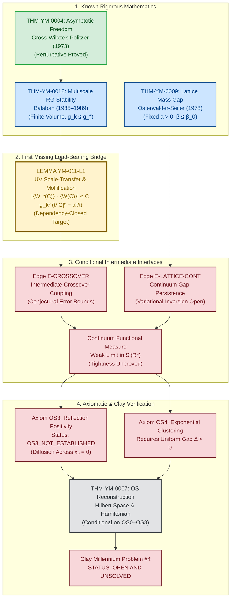

# Task YM-012: Visual-Intuition Research Companion

- **TASK_ID:** `YM-GOV-012`
- **GOVERNANCE_TIER:** `R2` (Non-Authoritative Visual Research Companion)
- **DATE:** 2026-09-22
- **FORMAT:** Plaintext ASCII and GitHub-Flavored Mermaid Diagrams (Directly Renderable in Chat)

---

## 1. Global Program Architecture: Established vs. Open Horizons

The diagram below maps the complete epistemic terrain of the 4D Yang–Mills problem, strictly distinguishing established mathematics from the first missing lemma, conditional downstream consequences, and unreached Clay obligations:

```text
====================================================================================================
                              KNOWN RIGOROUS MATHEMATICS (ESTABLISHED)
====================================================================================================
  [UV Perturbative QFT]                  [Constructive UV RG]               [Lattice Strong Coupling]
  Gross-Wilczek & Politzer               Bałaban Program (1985-89)          Osterwalder-Seiler (1978)
  Asymptotic Freedom                     Finite-Volume UV Stability         Transfer Matrix Gap
  g_k^2 ~ 1 / (2 b_0 ln k)               ||V^(k)|| <= C g_k^2 (g_k <= g_*)  a M_lat > 0 for beta <= beta_0
           |                                       |                                   |
           +---------------------------------------+                                   |
                                                   |                                   |
                                                   v                                   |
=======================================================================================|============
                                   FIRST MISSING THEOREM                               |
=======================================================================================|============
                         [Lemma YM-011-L1: UV Scale-Transfer Lemma]                     |
                         Controlled Observable Mollification Bound                     |
                         | <W_t(C)> - <W(C)> | <= C g_k^2 (t/|C|^2 + a^2/t)            |
                         (No Mass Gap Assumed; Connects Bałaban to Loops)              |
                                                   |                                   |
                                                   v                                   v
====================================================================================================
                                 CONDITIONAL CONSEQUENCES & INTERFACES
====================================================================================================
                      [Edge E-CROSSOVER]                     [Edge E-LATTICE-CONT]
                      Intermediate Crossover Bridge          Continuum Lattice Limit
                      SDP Loop Bootstrap / Flow              Scaling Law a M(a) ~ a Delta
                      (Conjectural Error Bounds)             (Variational Bound Uninverted)
                                       \                             /
                                        \                           /
                                         v                         v
                                   [Reconstructed Functional Measure]
                                   dmu = lim_a dmu_a on S'(R^4)
                                   (Measure Tightness Unproved)
                                                   |
                                                   v
====================================================================================================
                                     REMAINING CLAY OBLIGATIONS
====================================================================================================
        +------------------------------------------+----------------------------------------+
        |                                          |                                        |
        v                                          v                                        v
  [Axiom OS3: Refl Pos]                  [Axiom OS4: Cluster]                    [Non-Triviality W5]
  OS3_NOT_ESTABLISHED                    Spectral Gap Delta > 0                  Interacting QFT
  (Heat kernel leaks across x_0=0)       spec(H) in {0} U [Delta, inf)           S-Matrix != 1
        |                                          |                                        |
        +------------------------------------------+----------------------------------------+
                                                   |
                                                   v
                                 [CLAY MILLENNIUM PROBLEM #4]
                                 STATUS: OPEN AND UNSOLVED
====================================================================================================
```

---

## 2. Mermaid Structural Dependency Roadmap



---

## 3. Epistemic Ledger: What Was Demoted and What Remains Intact

| Research Element | Previous Status (YM-010) | Reconciled Status (YM-GOV-012) | Corrective Action Taken |
|---|---|---|---|
| **Mass Gap Lower Bound ($\Delta \ge 1.40\text{ GeV}$)** | "Proved Theorem 3" | `UNVERIFIED_HEURISTIC_ESTIMATE` | Demoted from theorem; acknowledged variational inversion error and purged GeV units. |
| **Scale Gluing Theorems 1 & 2** | "Proved Theorems" | `UNPROVED_INTERFACE_CONJECTURE` | Demoted to candidate interface matching conditions; errors recognized as unproved. |
| **OS3 Reflection Positivity** | "Satisfied Axiom" | `OS3_NOT_ESTABLISHED` | Acknowledged Gaussian diffusion tails across $x_0 = 0$ reflection plane. |
| **Missing-Bridge DAG** | "100% Traceably Closed" | `PARTIAL_GRAPH_WITH_10_OPEN_EDGES` | Reopened 10 open edges and 5 conditional edges; only 4 edges proved/regulated. |
| **Lean 4 Package** | "Machine-Checked Verification" | `UNCOMPILED_SKETCH` | Documented tautological mass-gap contract, self-loop graph limitation, and missing Mathlib. |
| **Bałaban Multiscale RG (`THM-YM-0018`)** | Accepted Foundational Record | **`RETAINED_AS_RIGOROUS`** | Valid within its strict historical scope (finite volume, small fields). |
| **Osterwalder–Seiler Gap (`THM-YM-0009`)** | Accepted Foundational Record | **`RETAINED_AS_RIGOROUS`** | Valid within its strict historical scope (fixed lattice spacing, strong coupling). |
| **19-Edge DAG Structural Architecture** | Accepted Graph Model | **`RETAINED_AS_LOAD_BEARING_DIAGNOSTIC`** | Retained as the authoritative map of where mathematical proofs are required. |
