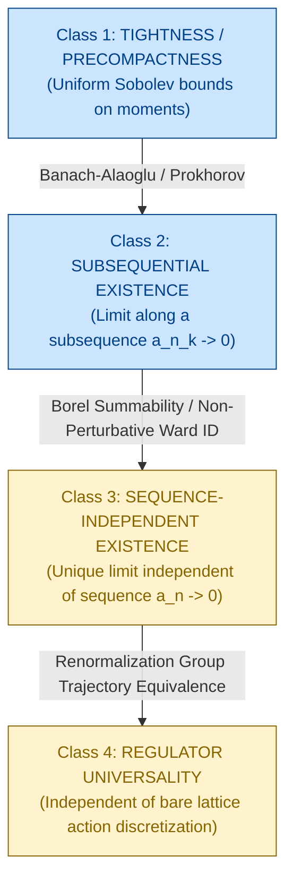

# YM-015-TARGET — Finite-Physical-Volume UV Continuum Construction

- **Target Identifier:** `YM-015-TARGET`
- **Task Association:** `YM-015 — E-UV-FREE-CONT`
- **Governance Classification:** Formal Scientific Specification
- **Authoritative Baseline:** State Revision 30 (Post YM-014R Reconciliation)
- **Status:** `ACTIVE_TARGET`

---

## 1. Mathematical Objective & Missing-Bridge Context

The explicit purpose of `YM-015` is **NOT** to prove the Yang–Mills mass gap or claim solution to the Clay Millennium Problem (`CLAY_PROBLEM = OPEN_AND_UNSOLVED`, `goal_complete = false`, `P3 = OPEN`).

The objective is to establish the load-bearing bridge edge:
$$\mathbf{E\text{-}UV\text{-}FREE\text{-}CONT}: \quad \text{Regulated Lattice Gauge Theory in Asymptotic Freedom Basin} \;\longrightarrow\; \text{Cutoff-Independent Continuum Schwinger Distributions}$$
in a **fixed, finite physical volume** $V = L_{\mathrm{phys}}^4 < \infty$, together with a separately proved restoration of continuous Euclidean translation covariance and continuous $SO(4)$ rotational covariance (Osterwalder–Schrader Axiom OS1).

This construction sits strictly upstream of:
1. The intermediate non-perturbative crossover window ($g_k \sim 1$, `E-CROSSOVER`);
2. The thermodynamic limit ($L_{\mathrm{phys}} \to \infty$);
3. Infinite-volume exponential clustering;
4. The physical mass gap ($\Delta > 0$).

---

## 2. Geometric & Physical Setup

1. **Gauge Group:** $G = SU(N)$ for $N = 2, 3$ (and general $N \ge 2$). Lie algebra $\mathfrak{g} = \mathfrak{su}(N)$.
2. **Spacetime Dimension:** $d = 4$ Euclidean space.
3. **Physical Domain:** Fixed four-dimensional flat torus of physical size $L_{\mathrm{phys}} < \infty$:
   $$\mathbb{T}_{\mathrm{phys}}^4 = (\mathbb{R} / L_{\mathrm{phys}} \mathbb{Z})^4.$$
4. **Lattice Discretization Sequence:** A sequence of hypercubic lattices $\Lambda_n = (a_n \mathbb{Z} / L_{\mathrm{phys}} \mathbb{Z})^4$ with lattice spacing:
   $$a_n \to 0 \quad \text{as } n \to \infty, \qquad N_n = \frac{L_{\mathrm{phys}}}{a_n} \in 2\mathbb{N}.$$
5. **Bare Coupling Trajectory:** The bare coupling $\beta(a_n) = 2N / g_0^2(a_n)$ is tuned along the two-loop asymptotically-free scaling trajectory:
   $$g_0^2(a) = \frac{1}{2 b_0 \ln(1 / (a \Lambda_{\overline{\mathrm{MS}}}))} \left( 1 - \frac{b_1}{b_0^2} \frac{\ln(2\ln(1/(a\Lambda_{\overline{\mathrm{MS}}})))}{2\ln(1/(a\Lambda_{\overline{\mathrm{MS}}}))} + O\left(\frac{1}{\ln^2(1/(a\Lambda))}\right) \right),$$
   with 1-loop and 2-loop beta-function coefficients:
   $$b_0 = \frac{11 N}{48 \pi^2}, \qquad b_1 = \frac{34 N^2}{3 (16 \pi^2)^2}.$$
   In particular, $\beta(a_n) \to +\infty$ as $a_n \to 0$.
6. **Lattice Measure:** The Wilson lattice gauge measure:
   $$d\mu_{\Lambda_n, \beta_n}(U) = \frac{1}{Z_{\Lambda_n}(\beta_n)} \prod_{e \in E_+(\Lambda_n)} d\mu_{\mathrm{Haar}}(U(e)) \, \exp\!\left( \frac{\beta_n}{2N} \sum_{p \in P_+(\Lambda_n)} \left( \operatorname{Tr} U(p) + \operatorname{Tr} U(p)^\dagger - 2N \right) \right).$$

---

## 3. Observable Architecture

To avoid the singular UV contact divergences of unsmeared local point-operators, we define a two-scale observable family:

### 3.1 Two-Scale Flowed/Smeared Field-Strength Observables
For a fixed *physical* flow time $t_{\mathrm{phys}} > 0$ (independent of $a$):
1. **Lattice Wilson Flow:** For link variables $U \in SU(N)^{E_+}$, the lattice gradient flow $V_s(e)$ satisfies:
   $$a^2 \partial_s V_s(e) = -g_0^2 \left( \partial_{e} S_W(V_s) \right) V_s(e), \qquad V_0(e) = U(e), \quad s \in [0, t_{\mathrm{phys}}].$$
2. **Clover Field-Strength Tensor:** At each lattice site $x \in \Lambda_n$, the clover leaf holonomy combination yields the flowed field-strength tensor:
   $$G_{\mu\nu}^a(x; s)[U] = \frac{1}{4 a^2} \operatorname{Tr}\!\left( \lambda^a \left( Q_{\mu\nu}(x; s) - Q_{\nu\mu}(x; s) \right) \right),$$
   where $Q_{\mu\nu}(x; s)$ is the sum of the four plaquettes meeting at $x$ in the $(\mu, \nu)$ plane computed from flowed links $V_s$.
3. **Gauge-Invariant Scalar Density:**
   $$\mathcal{E}(x; t_{\mathrm{phys}})[U] := \frac{1}{2} \sum_{\mu, \nu=1}^4 \sum_{a=1}^{N^2-1} \left( G_{\mu\nu}^a(x; t_{\mathrm{phys}})[U] \right)^2 = \frac{1}{4} \operatorname{Tr}\!\left( G_{\mu\nu}(x; t_{\mathrm{phys}}) G_{\mu\nu}(x; t_{\mathrm{phys}}) \right).$$
4. **Smeared Test-Function Coupling:** For smooth test functions $f \in C^\infty(\mathbb{T}_{\mathrm{phys}}^4)$:
   $$\mathcal{O}_{a, t_{\mathrm{phys}}}(f)[U] := a^4 \sum_{x \in \Lambda_n} f(x) \left( \mathcal{E}(x; t_{\mathrm{phys}})[U] - \langle \mathcal{E}(x; t_{\mathrm{phys}}) \rangle_{\mu_a} \right).$$

---

## 4. Hierarchy of Existence Classes

To ensure mathematical precision, `YM-015` distinguishes four strictly separate levels of continuum existence:

1. **`TIGHTNESS / PRECOMPACTNESS`:** Uniform-in-$a$ bounds on all smeared $k$-point Schwinger correlators:
   $$\sup_{0 < a \le a_0} \left| \langle \mathcal{O}_{a, t_1}(f_1) \cdots \mathcal{O}_{a, t_k}(f_k) \rangle_{\mu_{\Lambda_a, \beta(a)}} \right| \le C_k(t_1, \dots, t_k) \prod_{i=1}^k \|f_i\|_{H^s(\mathbb{T}^4)}.$$
2. **`SUBSEQUENTIAL EXISTENCE`:** By weak compactness (Banach–Alaoglu / nuclear space Fréchet compactness), extraction of a subsequence $a_{n_j} \to 0$ converging to generalized distributions $S_k(f_1, \dots, f_k) \in \mathcal{D}'((\mathbb{T}_{\mathrm{phys}}^4)^k)$.
3. **`SEQUENCE-INDEPENDENT EXISTENCE`:** Proof that *every* subsequence converges to the same unique distribution limit $S_k$.
4. **`REGULATOR UNIVERSALITY`:** Proof that modifying the bare lattice action (e.g. Wilson vs. Symanzik improved vs. Manton) yields identical continuum Schwinger functions up to canonical field-strength renormalization.

---

## 5. Specification of Minimum Useful Theorem: `YM-015-TARGET`

The minimum theorem sufficient to close the missing-bridge edge `E-UV-FREE-CONT` is:

$$\begin{aligned}
&\textbf{Theorem (YM-015-TARGET — Minimum Smeared UV Continuum Limit):} \\
&\text{There exists a sequence } a_n \to 0 \text{ with bare couplings } \beta(a_n) \to \infty \text{ on } \mathbb{T}_{\mathrm{phys}}^4, \text{ a Sobolev index } s \ge 2, \\
&\text{and limiting multi-local distributions } S_k(t_1, \dots, t_k) \in \mathcal{D}'((\mathbb{T}_{\mathrm{phys}}^4)^k) \text{ such that for any } t_1, \dots, t_k > 0 \\
&\text{and test functions } f_1, \dots, f_k \in C^\infty(\mathbb{T}_{\mathrm{phys}}^4): \\
&1. \quad \lim_{j \to \infty} \left\langle \prod_{i=1}^k \mathcal{O}_{a_{n_j}, t_i}(f_i) \right\rangle_{\mu_{a_{n_j}}} = S_k(t_1, \dots, t_k)(f_1, \dots, f_k); \\
&2. \quad |S_k(t_1, \dots, t_k)(f_1, \dots, f_k)| \le C_k(t_1, \dots, t_k) \prod_{i=1}^k \|f_i\|_{H^s(\mathbb{T}^4)}; \\
&3. \quad S_k \text{ satisfies reflection positivity (OS2) across the Euclidean time reflection hyperplane } x_4 \mapsto -x_4; \\
&4. \quad S_k \text{ is continuous under continuous Euclidean translations: } \lim_{h \to 0} \|S_k(\tau_h f_1, \dots) - S_k(f_1, \dots)\| = 0; \\
&5. \quad S_k \text{ is invariant under continuous } SO(4) \text{ rotations: } S_k(R f_1, \dots, R f_k) = S_k(f_1, \dots, f_k) \quad \forall R \in SO(4).
\end{aligned}$$

---

## 6. Formal Non-Claims & Scope Boundaries

To prevent over-claiming, `YM-015-TARGET` explicitly does **NOT** assert:
1. **No Infinite-Volume Claim:** The physical torus size $L_{\mathrm{phys}} < \infty$ remains strictly fixed. The thermodynamic limit $L_{\mathrm{phys}} \to \infty$ is deferred to a subsequent governed edge.
2. **No Mass Gap Claim:** The existence of a strictly positive spectral gap in the physical continuum Hamiltonian is **not** asserted by this theorem.
3. **No Crossover Resolution Claim:** The intermediate non-perturbative crossover window ($g_k \sim 1$) is **not** closed by this theorem.
4. **No Clay Millennium Claim:** The Millennium Prize Problem remains `OPEN_AND_UNSOLVED` (`goal_complete = false`, `P3 = OPEN`).
