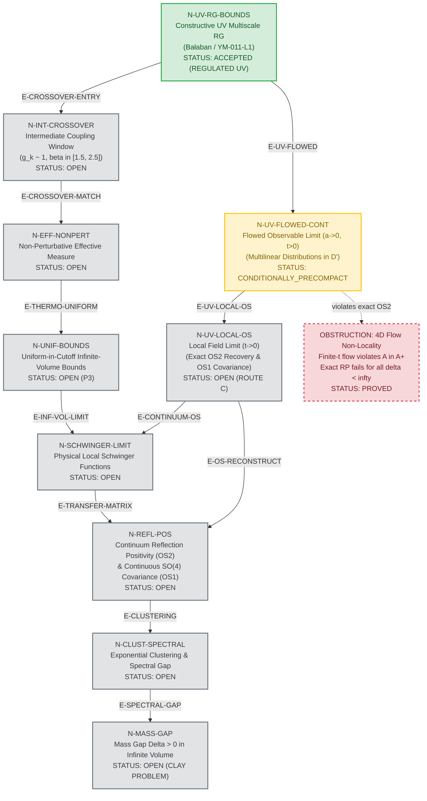

# YM-015R-CORRECTED-DAG: Reconstructed Missing-Bridge Dependency DAG, Decomposed UV Continuum Edge, and Task Routing

- **Document Identifier:** `YM-015R-CORRECTED-DAG`
- **Task Association:** `YM-015R — Post-Acceptance Stress Test and Scientific Repair`
- **Missing-Bridge Edges:** `E-UV-FREE-CONT`, `E-CROSSOVER`, and Full Missing-Bridge Graph
- **Governance Classification:** Authoritative DAG Artifact (Post-Reconciliation)
- **Status:** `AUTHORITATIVE_DAG_RECONSTRUCTED`

---

## 1. Executive Summary

Task `YM-015R` established that the single missing-bridge edge `E-UV-FREE-CONT` (regulated lattice observables $\to$ cutoff-independent continuum Schwinger distributions with exact OS axioms) cannot be closed in a single step using 4D gradient flow at finite flow time $t > 0$.

Because 4D gradient flow violates exact Osterwalder–Schrader reflection positivity (OS2) at any finite $t > 0$, the edge must be decomposed into two distinct, mathematically necessary stages:
1. **`N-UV-FLOWED-CONT` (`E-UV-FLOWED`):**
   Cutoff removal $a \to 0$ for flowed observables at fixed physical flow time $t > 0$.
   *Status:* Partially bridged (weak-* precompactness in projective nuclear topology established; uniform bound L1 remains conditional on non-perturbative flow contractivity; $SO(4)$ restoration L5 is perturbative).
2. **`N-UV-LOCAL-OS` (`E-UV-LOCAL-OS`):**
   The vanishing flow-time limit $t \downarrow 0$ inside Osterwalder–Schrader bilinear forms, recovering exact reflection positivity (OS2) as the heat-kernel leakage defect $\Delta_{\mathrm{RP}} \le C e^{-\delta^2/(4t)} \to 0$, alongside continuous Euclidean covariance (OS1).
   *Status:* **`OPEN_AND_UNRESOLVED`**.

Consequently, the overall edge `E-UV-FREE-CONT` remains **`OPEN_AND_UNRESOLVED`**.

---

## 2. Corrected Fine-Grained Missing-Bridge Dependency DAG

---

## 3. Epistemic Status Ledger of All Edges

| Edge ID | Source Node $\to$ Target Node | Pre-YM-015R Status | Post-YM-015R Reconciled Status | Edge Disposition |
| :--- | :--- | :--- | :--- | :--- |
| **`E-UV-FLOWED`** | `N-UV-RG-BOUNDS` $\to$ `N-UV-FLOWED-CONT` | Unspecified | **`CONDITIONALLY_PRECOMPACT`** | Precompactness in $\mathcal{D}'$ holds conditionally on L1; bound is perturbative on rough fields. |
| **`E-UV-LOCAL-OS`** | `N-UV-FLOWED-CONT` $\to$ `N-UV-LOCAL-OS` | Unspecified | **`OPEN_AND_UNRESOLVED`** | Local limit $t \downarrow 0$ required to eliminate RP defect $\Delta_{\mathrm{RP}} \sim e^{-\delta^2/(4t)}$. |
| **`E-UV-FREE-CONT`** | `N-UV-RG-BOUNDS` $\to$ `N-SCHWINGER-LIMIT` | `ACCEPTED` (Rev 31) | **`OPEN_AND_UNRESOLVED`** | Downgraded from accepted; composite edge requires both `E-UV-FLOWED` and `E-UV-LOCAL-OS`. |
| **`E-CROSSOVER`** | `N-UV-RG-BOUNDS` $\to$ `N-EFF-NONPERT` | `OPEN` | **`OPEN`** | Unchanged; intermediate non-perturbative matching ($g_k \sim 1$) unbridged. |
| **`E-THERMO-UNIFORM`** | `N-EFF-NONPERT` $\to$ `N-UNIF-BOUNDS` | `OPEN` | **`OPEN`** | Volume uniformity $L_{\mathrm{phys}} \to \infty$ unbridged (`P3 = OPEN`). |
| **`E-SPECTRAL-GAP`** | `N-CLUST-SPECTRAL` $\to$ `N-MASS-GAP` | `OPEN` | **`OPEN`** | Clay Millennium Problem remains open and unsolved. |

---

## 4. Governance Disposition and Next Task Routing

1. **Invariants Preserved:**
   - `goal_complete`: **`false`**
   - `clay_problem`: **`OPEN_AND_UNSOLVED`**
   - `P3`: **`OPEN`**
   - `E-CROSSOVER`: **`OPEN`**
   - `STRUCTURAL_NO_GO_COUNT`: **`0`**
2. **Successor Task Blocking:**
   - **`YM-016`** remains **`BLOCKED_PENDING_YM-015R`**.
   - No attempt to execute the crossover bridge may assume that the continuum limit has been fully constructed with exact OS axioms.
   - Any future task bridging the UV continuum must implement **Route C** (Two-Stage Flowed-to-Local Limit) and derive explicit non-perturbative bounds controlling both the $a \to 0$ and $t \downarrow 0$ limits.
