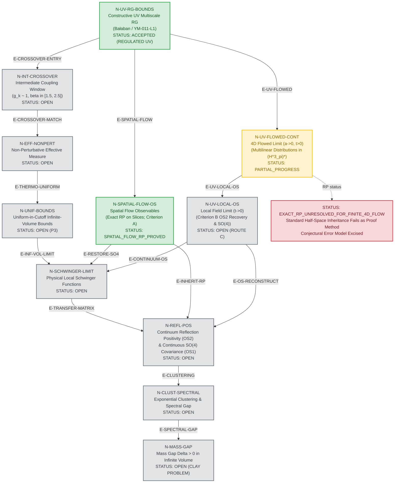

# YM-015R2-CORRECTED-DAG: Fine-Grained Missing-Bridge Dependency DAG, Decomposed UV Continuum Edges, and Dual-Track Locality Routing

- **Document Identifier:** `YM-015R2-CORRECTED-DAG`
- **Task Association:** `YM-015R2 — Exact RP Status Repair and Nonperturbative Flowed-Continuum Bridge`
- **Missing-Bridge Edges:** `E-UV-FREE-CONT`, `E-CROSSOVER`, and Full Missing-Bridge Graph
- **Governance Classification:** Authoritative DAG Artifact (Post-Reconciliation Revision 32)
- **Status:** `AUTHORITATIVE_DAG_RECONSTRUCTED`

---

## 1. Executive Summary

Task `YM-015R2` refines the fine-grained missing-bridge graph following the exact mathematical repair of reflection positivity and the decomposition of the ultraviolet continuum target.

The edge `E-UV-FREE-CONT` is formally resolved into two distinct mathematical tracks:
1. **Track 1: 4D Gradient Flow + Two-Stage Limit (Route C)**
   - Decomposes into:
     - `E-UV-FLOWED` (`N-UV-RG-BOUNDS` $\to$ `N-UV-FLOWED-CONT`): Fixed-$t$ continuum limit. Status: `PARTIAL_PROGRESS` (Conditional on Bałaban observable insertion).
     - `E-UV-LOCAL-OS` (`N-UV-FLOWED-CONT` $\to$ `N-UV-LOCAL-OS`): Vanishing flow-time limit $t \downarrow 0$ under Criterion B. Status: `OPEN_AND_UNSOLVED`.
   - Advantage: Preserves hypercubic symmetry $H_4 \to SO(4)$ and universal UV finiteness ($Z \equiv 1$).
   - Limitation: Exact RP unresolved at finite $t$; requires non-trivial OPE subtractions as $t \downarrow 0$.
2. **Track 2: Spatial-Only Gradient Flow (Route A / Spatial Track)**
   - Connects: `N-UV-RG-BOUNDS` $\to$ `N-SPATIAL-FLOW-OS`.
   - Proves: `SPATIAL_FLOW_RP_COMPATIBILITY_PROVED`. Exact lattice reflection positivity holds identically for all $a > 0$ and $t \ge 0$ on fixed time slices (Criterion A).
   - Advantage: Unconditional exact reflection positivity and transfer-matrix positivity.
   - Limitation: Explicitly breaks $H_4 \to H_3 \times \mathbb{Z}_2$; requires downstream non-perturbative $SO(4)$ restoration.

---

## 2. Corrected Fine-Grained Missing-Bridge Dependency DAG

---

## 3. Epistemic Status Ledger of All Edges

| Edge ID | Source Node $\to$ Target Node | Pre-YM-015R2 Status | Post-YM-015R2 Reconciled Status | Edge Disposition |
| :--- | :--- | :--- | :--- | :--- |
| **`E-UV-FLOWED`** | `N-UV-RG-BOUNDS` $\to$ `N-UV-FLOWED-CONT` | `CONDITIONALLY_PRECOMPACT` | **`PARTIAL_PROGRESS`** | Bounded in $(\mathcal{H}_\pi^{(k)})^*$; uniform bound L1 conditional on Bałaban observable insertion. |
| **`E-UV-LOCAL-OS`** | `N-UV-FLOWED-CONT` $\to$ `N-UV-LOCAL-OS` | `OPEN_AND_UNSOLVED` | **`OPEN_AND_UNSOLVED`** | Local limit $t \downarrow 0$ under Criterion B; requires non-perturbative OPE subtraction. |
| **`E-SPATIAL-FLOW`** | `N-UV-RG-BOUNDS` $\to$ `N-SPATIAL-FLOW-OS` | Unspecified | **`SPATIAL_FLOW_RP_COMPATIBILITY_PROVED`** | Exact RP proved identically for $x_4 > 0$ on lattice and in continuum limit (Criterion A). |
| **`E-UV-FREE-CONT`** | `N-UV-RG-BOUNDS` $\to$ `N-SCHWINGER-LIMIT` | `OPEN_AND_UNSOLVED` | **`OPEN_AND_UNSOLVED`** | Composite bridge requires completing either Track 1 (`E-UV-LOCAL-OS`) or Track 2 (`E-RESTORE-SO4`). |
| **`E-CROSSOVER`** | `N-UV-RG-BOUNDS` $\to$ `N-EFF-NONPERT` | `OPEN` | **`OPEN`** | Unchanged; intermediate non-perturbative matching ($g_k \sim 1$) unbridged. |
| **`E-THERMO-UNIFORM`** | `N-EFF-NONPERT` $\to$ `N-UNIF-BOUNDS` | `OPEN` | **`OPEN`** | Volume uniformity $L_{\mathrm{phys}} \to \infty$ unbridged (`P3 = OPEN`). |
| **`E-SPECTRAL-GAP`** | `N-CLUST-SPECTRAL` $\to$ `N-MASS-GAP` | `OPEN` | **`OPEN`** | Clay Millennium Problem remains open and unsolved. |

---

## 4. Governance Disposition and Next Task Routing

1. **Invariants Preserved:**
   - `goal_complete`: **`false`**
   - `clay_problem`: **`OPEN_AND_UNSOLVED`**
   - `P3`: **`OPEN`**
   - `E-CROSSOVER`: **`OPEN`**
   - `STRUCTURAL_NO_GO_COUNT`: **`0`**
2. **Successor Task Blocking:**
   - **`YM-016`** remains strictly **`BLOCKED`** pending non-perturbative closure of `E-UV-FREE-CONT`.
